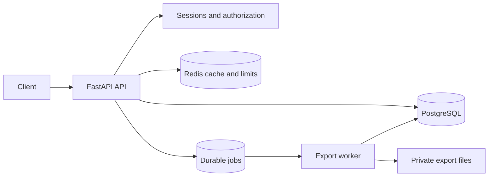

# TaskForge Design

## Project

TaskForge is a modular-monolith backend for multi-tenant project/task management and asynchronous CSV exports.

PostgreSQL owns durable state. Redis owns disposable cache and rate-limit data. The API and worker are separate processes that share the same database and application package.

## High-level design



### Components

| Component | Responsibility |
|---|---|
| FastAPI API | HTTP routing, validation, authentication, authorization, transactions, response mapping, request IDs, and access logs |
| PostgreSQL | Users, sessions, memberships, projects, tasks, audit events, exports, jobs, idempotency records, leases, retries, and artifact metadata |
| Redis | Project-summary cache and rate-limit counters; disposable dependency data |
| Export worker | Claims jobs, renews leases, generates CSV files, retries eligible failures, finalizes artifacts, and updates job/export state |
| Private file storage | Attempt-specific temporary files and finalized export files |
| Locust | Authenticated load generation and latency/failure reporting |

### Request flow

```text
Client
  -> Uvicorn
  -> FastAPI middleware
  -> authentication
  -> workspace authorization
  -> service
  -> repository
  -> PostgreSQL / Redis
  -> response
```

### Export flow

```text
POST /exports
  -> authenticate and authorize workspace
  -> create export(pending)
  -> create job(pending)
  -> create idempotency record
  -> COMMIT
  -> return 202

Worker
  -> claim pending or expired job
  -> assign owner token and lease
  -> COMMIT running state
  -> generate CSV outside transaction
  -> write attempt-specific artifact
  -> checksum and finalize artifact
  -> conditionally update job/export using owner token
  -> COMMIT
```

## Low-level design

### Source modules

| Module | Responsibility |
|---|---|
| `src/taskforge/main.py` | App factory, middleware, exception handlers, Redis lifecycle, database lifecycle, and health endpoint |
| `src/taskforge/api.py` | HTTP route handlers, dependencies, CSRF checks, rate-limit checks, and response status codes |
| `src/taskforge/config.py` | Environment-backed settings and bounds for pool, worker, lease, storage, and request limits |
| `src/taskforge/models.py` | Pydantic request and response models |
| `src/taskforge/auth_service.py` | Registration, login, logout, session lookup, and CSRF-token validation |
| `src/taskforge/authorization_service.py` | Workspace membership and resource authorization |
| `src/taskforge/repositories.py` | Project/task PostgreSQL operations and optimistic task updates |
| `src/taskforge/authorization_repository.py` | Membership-scoped project/task queries and tenant-bound list/search operations |
| `src/taskforge/auth_repository.py` | User and session persistence |
| `src/taskforge/jobs.py` | Export/job repository, claims, leases, retries, CSV generation, checksums, artifact cleanup, and finalization |
| `src/taskforge/worker.py` | Polling worker and bounded thread concurrency |
| `src/taskforge/cache.py` | Project-summary cache-aside behavior and invalidation |
| `src/taskforge/rate_limit.py` | Redis-backed rate-limit algorithm and test fallback |
| `src/taskforge/realtime.py` | Process-local bounded WebSocket subscriber broker |
| `src/taskforge/observability.py` | Bounded process-local HTTP counters and duration buckets |
| `src/taskforge/db.py` | SQLAlchemy engine and session factory creation |
| `src/taskforge/db_models.py` | SQLAlchemy table mappings |
| `migrations/versions/` | Versioned schema changes |

### Database model

```text
users
  -> memberships -> workspaces
workspaces
  -> projects
projects
  -> tasks
tasks
  -> audit_events
exports
  -> jobs
idempotency_keys
  -> exports
sessions
  -> users
```

Important constraints and invariants:

- `memberships(user_id, workspace_id)` is unique.
- `idempotency_keys(user_id, key)` is unique.
- A job points to one export through `jobs.export_id`.
- Workspace authorization is enforced through membership-scoped queries.
- Task updates use a version condition to prevent silent lost updates.
- Job completion requires the current owner token.
- Job claims use row locking and skip locked rows.
- Export and job acceptance commit atomically.

### Authentication and authorization

1. Login verifies the password hash.
2. The server stores a hash of the session token and CSRF token.
3. The session token is sent in an HttpOnly cookie.
4. Unsafe cookie-authenticated requests require the CSRF header.
5. Workspace-scoped routes resolve membership before returning or changing data.
6. Cache and file paths are resolved only after authorization.

### Task update flow

```text
PATCH task(expected_version=N)
  -> authenticate
  -> authorize workspace/project/task
  -> UPDATE task WHERE version=N
  -> if zero rows: 409 stale_task_version
  -> insert audit event in same transaction
  -> commit
```

### Job ownership and recovery

Jobs store status, attempt, max attempts, owner token, lease expiry, retry time, timestamps, error, output location, and artifact checksum data.

```text
pending
  -> running(owner token, lease)
  -> succeeded
  -> failed

running + expired lease
  -> reclaim with new owner token and incremented attempt
```

Lease expiry does not prove that the old worker stopped. The owner token prevents a stale worker from completing the job after reclaim. Stale attempt files are cleaned up and are not published as the authoritative export.

### Cache behavior

- Redis stores project-summary cache entries only.
- PostgreSQL is queried for authorization before cache access.
- Task/project writes invalidate summary cache entries after commit.
- Redis failure must not make PostgreSQL data disappear.

### Scaling and resource limits

- API database pool is bounded.
- Worker concurrency is bounded.
- Request body size and list page size are bounded.
- Rate limits are shared through Redis.
- Export jobs are processed outside short claim transactions.
- Adding API instances increases aggregate connection demand; pool sizes must be calculated across all processes.

## Local deployment

```text
Host
  ├── Uvicorn/FastAPI API
  ├── TaskForge export worker
  └── Docker Compose
        ├── PostgreSQL
        └── Redis
```

The local load experiment found PostgreSQL pool exhaustion with five connections and zero overflow. A local rerun with 20 connections and 10 overflow reduced failures from approximately 58.64% to 0.03%. This setting is not a production capacity recommendation.

