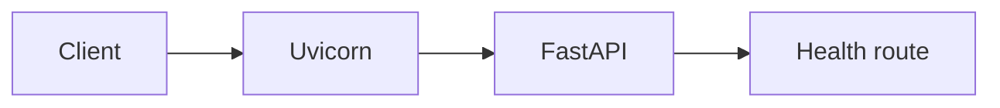
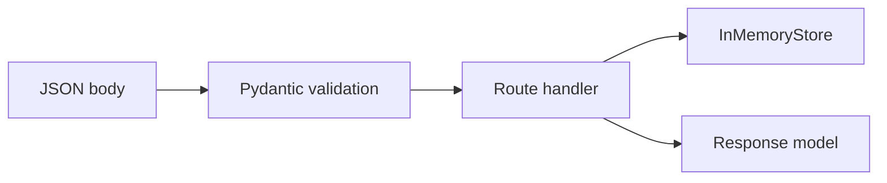
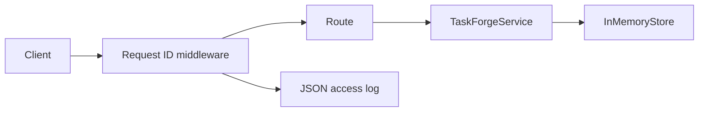
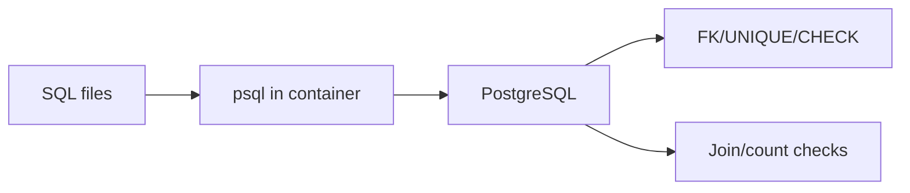
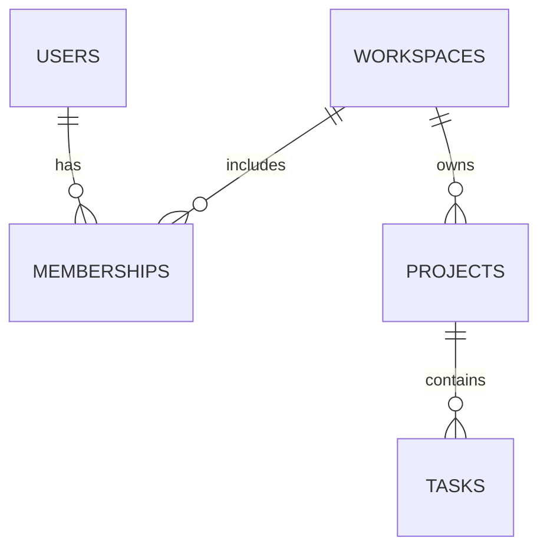
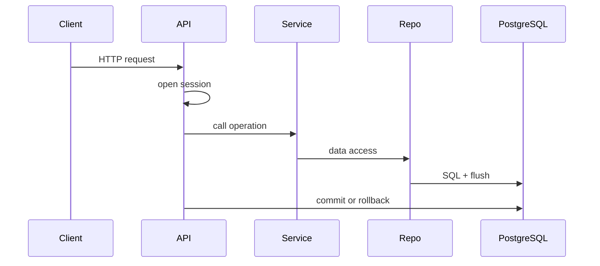
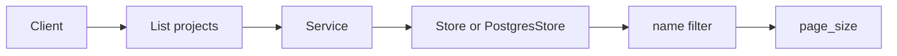
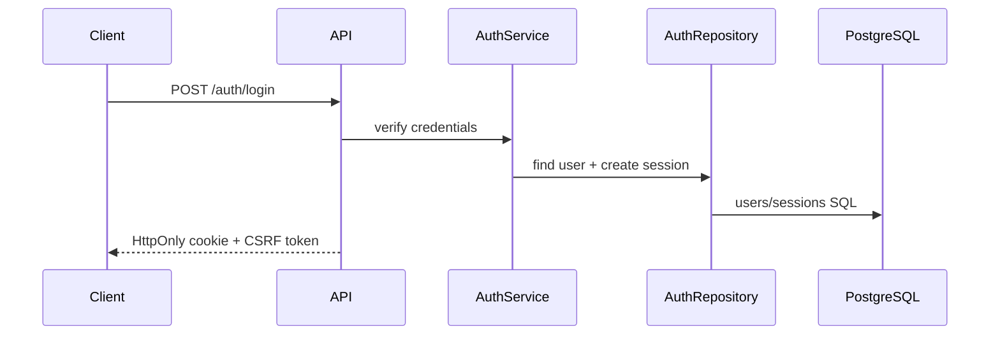
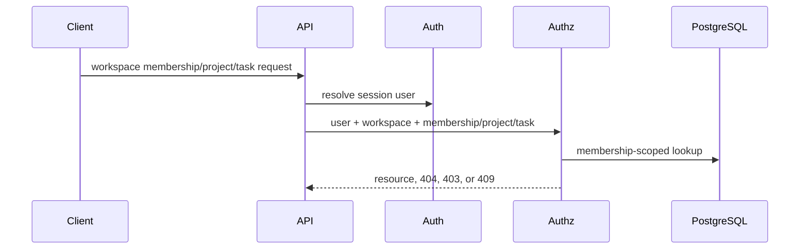

# TaskForge Design Evolution

## Purpose
TaskForge is a learning backend for a multi-user project and task system. The design record exists to keep implementation reality, trade-offs, and limitations visible as the project grows.

## Design principles
- Keep one modular monolith until there is a demonstrated need to split services.
- Prefer explicit boundaries over hidden framework behavior.
- Make authorization, transactions, resource ownership, retries, and storage ownership visible in code and documentation.
- Treat validation evidence and learner understanding as separate requirements.
- Label planned or unverified behavior instead of presenting it as implemented.

## Current architecture snapshot
- Last updated: 2026-09-14
- Roadmap day/module and implementation status: Day 10 / W2.3 transactions and concurrent writes started; Day 9 authorization route surface is implemented and validated.

### Layer summary
- API layer: `src/taskforge/main.py` creates the FastAPI app; `src/taskforge/api.py` owns `/api/v1` route registration, HTTP status/header behavior, and service-error mapping.
- Middleware/error boundary: `src/taskforge/main.py` owns request ID propagation, structured access logs, and exception handlers for HTTP and validation errors.
- Configuration layer: `src/taskforge/config.py` owns startup settings loaded from environment variables and validates environment/log-level values.
- Model/contract layer: `src/taskforge/models.py` owns request/response shapes, unknown-field rejection, UUID serialization, field limits, PATCH body validation, and missing-versus-null semantics.
- Service layer: `src/taskforge/services.py` owns legacy project/task application rules. `src/taskforge/authorization_service.py` owns authenticated workspace/project/task/membership authorization decisions for the Day 9 route slice.
- Error model: `src/taskforge/errors.py` owns application exception types.
- Persistence layer: `src/taskforge/repositories.py` owns legacy PostgreSQL CRUD through SQLAlchemy sessions. `src/taskforge/authorization_repository.py` owns membership-scoped workspace/project/task/membership data access. `src/taskforge/store.py` remains process-local memory storage for focused tests only. `src/taskforge/db.py` owns engine/sessionmaker construction. `src/taskforge/db_models.py` owns ORM table mappings. Alembic migrations live under `migrations/`.
- Worker/background layer: not implemented.

### File ownership
- `AGENTS.md`: tutoring and repository operating contract.
- `roadmap.md`: canonical 28-day curriculum.
- `README.md`: setup commands, validation commands, current behavior, endpoints, and limitations.
- `.env.example`: non-secret local configuration example.
- `.gitignore`: excludes local environment, caches, generated bytecode, `.env`, and `.dist/` logs.
- `pyproject.toml`: Python package metadata and tool configuration.
- `src/taskforge/config.py`: settings model and cached settings provider.
- `src/taskforge/main.py`: FastAPI application factory, health route, API router inclusion, middleware, logging setup, and exception handlers.
- `src/taskforge/api.py`: `/api/v1` project/task routes and service-error mapping.
- `src/taskforge/models.py`: Pydantic models for project/task create, update, and read bodies.
- `src/taskforge/services.py`: business rules and application operations.
- `src/taskforge/errors.py`: application exception classes.
- `src/taskforge/store.py`: in-memory project/task storage for focused tests.
- `src/taskforge/db.py`: SQLAlchemy engine and session factory construction.
- `src/taskforge/db_models.py`: SQLAlchemy ORM table mappings, including users, sessions, workspaces, memberships, projects, and tasks.
- `src/taskforge/repositories.py`: PostgreSQL project/task repository implementation.
- `src/taskforge/security.py`: password hashing and high-entropy token generation/hash helpers.
- `src/taskforge/auth_repository.py`: PostgreSQL user/session persistence for authentication.
- `alembic.ini`: Alembic configuration.
- `migrations/env.py`: Alembic migration environment.
- `migrations/versions/0001_initial_schema.py`: initial PostgreSQL schema migration.
- `tests/test_health.py`: health endpoint smoke test.
- `tests/test_projects_tasks.py`: Day 2 HTTP contract tests plus UUID-aware missing-resource regression coverage.
- `tests/test_validation.py`: Day 3 validation tests.
- `tests/test_services.py`: Day 4 service-layer tests.
- `tests/test_app_boundaries.py`: Day 4 config, middleware, and logging tests.
- `docs/project-contract.md`: current supported endpoint and non-goals.
- `docs/tracker.md`: progress, evidence, blockers, and exact resume position.
- `docs/learning.md`: learning notes and corrections.
- `docs/session-log.md`: concise session handoffs.
- `docs/decisions.md`: durable architecture decisions.
- `docs/design.md`: current architecture snapshot and design history.

### Current capability map
- Implemented: `GET /health/live` returns `200 {"status":"ok"}`.
- Implemented: local settings load via Pydantic settings with `TASKFORGE_` environment prefix.
- Implemented: app construction fails on unsupported environment or log level values.
- Implemented: project CRUD under `/api/v1/projects`.
- Implemented: nested task CRUD under `/api/v1/projects/{project_id}/tasks`.
- Implemented: `page_size` bounds from 1 through 100 for list endpoints.
- Implemented: JSON error envelope for expected HTTP and validation errors.
- Implemented: request ID response header and JSON access logs without request bodies.
- Implemented: service-layer task status transition rule.
- Implemented: OpenAPI route generation through FastAPI, with test coverage for Day 2 paths.
- Implemented: optional case-insensitive project-name filtering with memory and PostgreSQL tests.
- Implemented: PostgreSQL repositories, migration tooling, request-scoped sessions, commit/rollback tests, isolated integration databases, and checked pool-demand reasoning across worker processes.
- Implemented: sessions table migration, password/token security helpers, and AuthRepository tests for active, expired, revoked, and missing sessions.
- Implemented: authenticated workspace creation; membership add/list/update/delete under `/api/v1/workspaces/{workspace_id}/memberships`; workspace project create/list/read/update/delete under `/api/v1/workspaces/{workspace_id}/projects`; workspace task create/list/read/update/delete under `/api/v1/workspaces/{workspace_id}/projects/{project_id}/tasks`; outsider `404`; in-tenant `403`; duplicate membership `409`; last-owner protection; and task parent-child swap protection.

### Data ownership and invariants
- Project and task data live in PostgreSQL when `TASKFORGE_STORAGE_BACKEND=postgres`, the default runtime setting.
- Deleting a project deletes its tasks through database cascade behavior in PostgreSQL and explicit cleanup in the memory test store.
- Task item routes verify the parent project exists before resolving the task through the service layer.
- Path IDs must be valid UUIDs before storage lookup.
- Task status cannot move directly from `todo` to `done`; `TaskForgeService` owns this rule.
- PostgreSQL is now the default runtime persistence backend. A configured default workspace owns unauthenticated development projects until auth/workspace isolation arrives.

### Request and background-job flows
- Health request flow:

```text
client -> middleware -> FastAPI route -> health handler -> middleware/log -> response
```

- Project/task request flow:

```text
client -> middleware -> /api/v1 route -> request DB session -> service -> PostgresStore -> PostgreSQL -> commit/rollback -> response
```

- Background jobs are planned for Week 3 and do not exist.

### High-level diagram
```mermaid
flowchart LR
    Client[Client] --> App[FastAPI app]
    App --> Routes[/api/v1 routes]
    Routes --> Service[Service]
    Service --> Repo[PostgresStore]
    Repo --> PG[(PostgreSQL)]
    App --> Logs[Request logs]
```

### Known limitations
- Authentication is implemented with server-side sessions, auth routes, cookies, expiry/revocation, and CSRF enforcement for cookie-authenticated unsafe mutations. Workspace-scoped project, task, and membership authorization are implemented for the Day 9 route surface. Legacy route reconciliation, worker, readiness check, global payload byte-size limit, and CI do not exist yet.
- Memory-backed tests are not evidence for database isolation, transaction behavior, or multi-process consistency; PostgreSQL integration tests cover the Day 6 persistence checks.
- Request ID logging is tested through FastAPI's test client but has not been manually inspected in a live Uvicorn terminal session.
- The test client emits dependency deprecation warnings that do not fail Day 4 but should be watched as dependencies evolve.

## Daily design history

### Day 1 - W1.1: Request journey and environment
- Calendar date(s): 2026-09-09
- Status: Completed

#### What changed
Initialized the learning records, added a minimal Python/FastAPI project, created a live health endpoint, added one smoke test, documented setup commands, and wrote the initial project contract.

#### Why the design changed
Day 1 needed the smallest backend that could demonstrate the HTTP request journey with working evidence. The endpoint is intentionally narrow so the learner can distinguish process liveness from deeper system readiness.

#### Boundary placement and ownership
`src/taskforge/main.py` owns HTTP app construction and route registration. `src/taskforge/config.py` owns environment-backed settings. There was no persistence/domain split because Day 1 had no business data.

#### API, data, and compatibility impact
Added `GET /health/live`, returning `200 {"status":"ok"}`. No database schema, auth contract, or backward-compatibility burden existed yet.

#### Request / job flow
A client request reaches Uvicorn, then FastAPI routing, then the health handler. The handler returns a static JSON body. Jobs are not applicable.



#### Verification and evidence
- `python --version`: Python 3.12.0.
- `py --version`: Python 3.12.0.
- `.\.venv\Scripts\python.exe -m pip install -e ".[dev]"`: succeeded.
- `.\.venv\Scripts\python.exe -m ruff check .`: passed.
- `.\.venv\Scripts\python.exe -m ruff format --check .`: passed after formatting.
- `.\.venv\Scripts\python.exe -m pytest -q`: `1 passed`, with two dependency deprecation warnings from FastAPI/Starlette test client internals.
- Live Uvicorn smoke check: `StatusCode=200`, body `{"status":"ok"}`.

#### Known limitations after this day
No auth, task CRUD, database, readiness/dependency health, TLS profile, or CI existed. The test client emitted dependency deprecation warnings that did not fail Day 1.

#### Related decisions and next design step
No ADRs. Next design step was Day 2 route and contract design.

### Day 2 - W1.2: Routing and API contracts
- Calendar date(s): 2026-09-09
- Status: Completed

#### What changed
Added resource-style project/task CRUD under `/api/v1`, initial Pydantic models, in-memory storage, bounded list endpoints, create `Location` headers, JSON error-envelope handlers, and HTTP contract tests.

#### Why the design changed
The project needed a first resource API with explicit HTTP semantics before introducing validation depth, persistence, authentication, or authorization. In-memory storage kept the Day 2 focus on route contracts instead of database behavior.

#### Boundary placement and ownership
`src/taskforge/api.py` owned route shape, method choice, status codes, and dependency access to the store. `src/taskforge/store.py` owned temporary object storage. `src/taskforge/models.py` owned the initial body schemas. `src/taskforge/main.py` owned app construction, health, router inclusion, and exception mapping.

#### API, data, and compatibility impact
Added project routes at `/api/v1/projects` and nested task routes at `/api/v1/projects/{project_id}/tasks`. Chose `PATCH` for partial updates. List endpoints accept `page_size` from 1 through 100. Expected errors are wrapped under an `error` key.

#### Request / job flow
A request entered FastAPI, matched a `/api/v1` route, validated path/query/body inputs, called the route handler, read or mutated `InMemoryStore`, and returned a JSON response. Jobs were not applicable.

```mermaid
flowchart LR
    Client[Client] --> API[FastAPI]
    API --> Route[/api/v1 route]
    Route --> Store[InMemoryStore]
    Store --> Route
```

#### Verification and evidence
- `.\.venv\Scripts\python.exe -m ruff check .`: passed.
- `.\.venv\Scripts\python.exe -m ruff format --check .`: passed.
- `.\.venv\Scripts\python.exe -m pytest -q`: `8 passed`, with two dependency deprecation warnings.
- Earlier failure: wrong-method 405 responses did not use the envelope because they came from Starlette's exception type. Fixed by handling `StarletteHTTPException`.

#### Known limitations after this day
Data was not durable. There was no auth, tenant isolation, database transaction, concurrency control, or persistence guarantee.

#### Related decisions and next design step
No ADRs. Next design step was Day 3 validation boundaries.

### Day 3 - W1.3: Serialization and validation
- Calendar date(s): 2026-09-09
- Status: Completed

#### What changed
Tightened request/response models, rejected unknown fields, parsed path IDs as UUIDs, clarified missing versus null PATCH behavior, rejected empty task PATCH bodies, added a domain rule for task status transitions, and added validation-focused tests.

#### Why the design changed
Day 2 proved route contracts, but the API still accepted some inputs too loosely. Day 3 made the boundary explicit so client mistakes are visible instead of silently ignored.

#### Boundary placement and ownership
Pydantic request models owned field shape, length, enum, extra-field, and empty-update validation. FastAPI path annotations owned UUID parsing. The in-memory store temporarily owned the task state-transition rule because no service layer existed yet. Routes translated store/domain failures into HTTP status codes.

#### API, data, and compatibility impact
Malformed UUID path IDs return `422` before store lookup. Valid UUIDs that are not present return `404`. Unknown request fields return `422` instead of being ignored. Direct `todo` to `done` task updates return `409 invalid_state_transition`.

#### Request / job flow
A request entered FastAPI, parsed JSON and UUID path parameters, validated the Pydantic request model, called the route, applied store/domain rules, and serialized through response models. Jobs were not applicable.



#### Verification and evidence
- Initial Day 3 validation tests failed for unknown fields, status transition, and invalid UUID handling. A later explicit-null test exposed that validation details containing raw `ValueError` objects must be JSON-encoded before returning them.
- `.\.venv\Scripts\python.exe -m ruff check .`: passed.
- `.\.venv\Scripts\python.exe -m ruff format --check .`: passed.
- `.\.venv\Scripts\python.exe -m pytest -q`: `18 passed`, with two dependency deprecation warnings.

#### Known limitations after this day
No global request body byte limit was implemented. No auth-sensitive response fields existed. Domain rules still lived close to the in-memory store and needed to move into a service layer on Day 4.

#### Related decisions and next design step
No ADRs. Next design step was Day 4 layer separation.

### Day 4 - W1.4: Layers and configuration
- Calendar date(s): 2026-09-09
- Status: Completed

#### What changed
Added `TaskForgeService`, application error classes, service tests, request ID middleware, structured access logs, startup settings validation, and config/middleware tests. Moved the task status-transition business rule out of storage and into the service layer.

#### Why the design changed
The code needed clearer ownership before database persistence and authorization arrive. Service methods give business rules a reusable home outside HTTP handlers and keep storage focused on data access.

#### Boundary placement and ownership
Routes own HTTP parsing results, response headers, status codes, and service-error mapping. `TaskForgeService` owns business rules and application-level missing-resource behavior. `InMemoryStore` owns mechanical reads/writes only. Exception handlers own public error envelopes. Middleware owns request IDs and access logging. `Settings` owns startup configuration validation.

#### API, data, and compatibility impact
No intentional endpoint shape change. Responses now include `X-Request-ID`. Access logs contain method, path, status code, duration, and request ID. Invalid startup environment/log-level values prevent app construction.

#### Request / job flow
A request enters middleware, receives or preserves a request ID, passes through FastAPI validation and route handling, calls the service, uses the store for temporary data, returns a response, adds `X-Request-ID`, and writes a structured log record. Jobs are not applicable.



#### Verification and evidence
- `.\.venv\Scripts\python.exe -m ruff check .`: passed.
- `.\.venv\Scripts\python.exe -m ruff format --check .`: passed.
- `.\.venv\Scripts\python.exe -m pytest -q`: `25 passed`, with two dependency deprecation warnings.
- `tests/test_services.py` verifies service ownership of the transition rule and store pass-through behavior.
- `tests/test_app_boundaries.py` verifies invalid config failure, request ID behavior, and structured logs without request bodies.

#### Known limitations after this day
Logging has not been inspected manually in a live Uvicorn terminal. There is still no database-backed repository, auth, tenant isolation, global payload byte-size limit, or CI.

#### Related decisions and next design step
Related: ADR-001 in `docs/decisions.md`. Next design step is Day 5: relational modeling, SQL constraints, and local PostgreSQL setup.

### Day 5 - W1.5: Relational modeling and SQL
- Calendar date(s): 2026-09-10
- Status: Completed

#### What changed
Added local PostgreSQL Compose setup on host port `5433`, initial SQL schema, seed data, SQL validation scripts, relational model documentation, and ADR-002. The API still uses the in-memory store; Day 5 is the modeling and database constraint lab.

#### Why the design changed
TaskForge needs durable integrity rules before the API is wired to PostgreSQL. Database constraints protect data written by any path, not just today's FastAPI handlers.

#### Boundary placement and ownership
`db/schema.sql` owns the planned relational structure and database-level constraints. `db/seed.sql` owns synthetic seed data. `tests/sql/constraints.sql` owns database integrity evidence. `tests/sql/queries.sql` owns join/query evidence. Runtime reads/writes still go through `InMemoryStore` until Day 6.

#### API, data, and compatibility impact
No runtime API behavior changed. The planned durable model includes users, workspaces, memberships, projects, and tasks. Tasks belong to workspaces through projects, so authorized task lookup joins memberships, projects, and tasks.

#### Request / job flow
Runtime request flow is unchanged from Day 4. Database validation flow is manual/lab-only: SQL files are copied into the PostgreSQL container and run with `psql`, then rolled back.





#### Verification and evidence
- Docker version: 28.0.4.
- Docker Compose version: v2.34.0-desktop.1.
- First `docker compose up -d postgres` timed out; retry revealed host port `5432` was allocated.
- Updated `compose.yaml` to map host `5433` to container `5432`.
- `docker compose up -d postgres`: succeeded.
- Container health: `healthy`.
- `psql -f tests/sql/constraints.sql`: passed and rolled back.
- `psql -f tests/sql/queries.sql`: passed and rolled back.
- `.\.venv\Scripts\python.exe -m ruff check .`: passed.
- `.\.venv\Scripts\python.exe -m ruff format --check .`: passed.
- `.\.venv\Scripts\python.exe -m pytest -q`: `25 passed`, with two dependency deprecation warnings.

#### Known limitations after this day
The API does not use PostgreSQL yet. There is no Alembic migration environment, upgrade path, request-scoped session, repository implementation, or integration test database isolation yet. Index design beyond implicit primary/unique indexes is deferred.

#### Related decisions and next design step
Related: ADR-002 in `docs/decisions.md`. Next design step is Day 6: persistence and migrations.


### Day 6 - W1.6: Persistence and migrations
- Calendar date(s): 2026-09-10
- Status: Completed

#### What changed
Added SQLAlchemy/psycopg dependencies, Alembic migration tooling, ORM mappings, a PostgreSQL repository, request-scoped database sessions, finite pool settings, isolated PostgreSQL integration tests, and PostgreSQL as the default runtime storage backend. Memory storage remains available for focused tests.

#### Why the design changed
The API needed durable CRUD behavior. Process memory could prove route contracts, but it could not survive restart, enforce database transactions, or prepare for authorization and background work.

#### Boundary placement and ownership
`src/taskforge/main.py` owns app construction, engine creation, pool settings, and lifespan disposal. `src/taskforge/api.py` owns the request-scoped session dependency: create service/repository, commit after success, rollback on exception, close the session. `src/taskforge/services.py` owns business rules and depends on a store protocol. `src/taskforge/repositories.py` owns SQL data access and uses `flush()` without committing. `migrations/` owns schema changes; requests do not run migrations.

#### API, data, and compatibility impact
Endpoint shapes did not intentionally change. With `TASKFORGE_STORAGE_BACKEND=postgres`, project/task data is durable and survives a new app instance. The unauthenticated development API writes projects into a configured default workspace. Existing API tests explicitly use the memory backend so they stay focused on contract behavior.

#### Request / job flow
A PostgreSQL-backed request enters middleware, passes FastAPI validation, opens a request-scoped SQLAlchemy session, builds a service with `PostgresStore`, executes repository SQL, commits after the handler succeeds, rolls back on exception, closes the session, and returns/logs the response. Jobs are not applicable yet.



#### Verification and evidence
- `.\.venv\Scripts\python.exe -m pip install -e ".[dev]"`: installed Alembic, SQLAlchemy, and psycopg dependencies.
- `.\.venv\Scripts\python.exe -m ruff check .`: passed.
- `.\.venv\Scripts\python.exe -m ruff format --check .`: passed.
- `.\.venv\Scripts\python.exe -m pytest -q`: `28 passed`, with two dependency deprecation warnings.
- `tests/test_postgres_persistence.py` creates/drops isolated PostgreSQL databases, runs Alembic migrations, verifies persisted data across app instances, and verifies rollback removes uncommitted multi-step work. Manual API testing also verified that a created project still appears after stopping and restarting Uvicorn.

#### Known limitations after this day
Authentication and real workspace authorization are still absent. The default workspace is a local development bridge, not a security model. The existing developer `taskforge` database may contain Day 5 manual schema without Alembic version state; use a fresh database or deliberate migration stamping before treating that database as migrated. N+1 query behavior has not been measured.

#### Related decisions and next design step
Related: ADR-003 in `docs/decisions.md`. Learner explained total pool demand across worker processes. Next design step is Day 7 foundation review.

### Day 7 - W1.7: Foundation review
- Calendar date(s): 2026-09-11
- Status: Completed

#### What changed
Added optional `name_contains` filtering to `GET /api/v1/projects`, with case-insensitive substring matching in both the memory test store and PostgreSQL repository. Added memory-backed HTTP tests and PostgreSQL integration tests for filter behavior and page-size interaction.

#### Why the design changed
The review implementation task checks whether Week 1 boundaries are understood well enough to make a small feature pass through route, service, repository, and tests without breaking existing contracts.

#### Boundary placement and ownership
`src/taskforge/api.py` owns the query parameter contract. `src/taskforge/services.py` forwards the filter through the store protocol. `src/taskforge/store.py` implements in-memory filtering for focused tests. `src/taskforge/repositories.py` implements SQL filtering with case-insensitive matching. Tests verify both memory-backed HTTP behavior and real PostgreSQL repository behavior.

#### API, data, and compatibility impact
`GET /api/v1/projects` remains backward compatible. `name_contains` is optional, rejects an empty value through query validation, filters case-insensitively, and still applies `page_size` after filtering.

#### Request / job flow
Project list requests now optionally include a filter before ordering/limiting results. Jobs are not applicable.



#### Verification and evidence
- Learner debugged the broken `COUNT(*)` with `LEFT JOIN` query and corrected it to `COUNT(t.id)` with explicit grouping.
- `.\.venv\Scripts\python.exe -m ruff check .`: passed.
- `.\.venv\Scripts\python.exe -m ruff format --check .`: passed.
- `.\.venv\Scripts\python.exe -m pytest -q`: `34 passed`, with two dependency warnings.
- Fresh-start rehearsal in `C:\tmp\taskforge-fresh-20260911`: clean venv creation succeeded, editable install succeeded, ruff check passed, format check passed, and pytest passed with `34 passed`.

#### Known limitations after this day
Fresh-start rehearsal used a clean local copy rather than a separate remote clone. Authentication and real workspace authorization remain future work.

#### Related decisions and next design step
Related: ADR-004 records PostgreSQL as the Week 1 runtime source of truth. Next design step is Day 8 authentication and sessions.

### Day 8 - W2.1: Authentication and sessions
- Calendar date(s): 2026-09-11
- Status: Completed

#### What changed
Added a sessions table migration, password/token security helpers, auth request/response models, `AuthRepository`, `AuthService`, and auth routes for registration, login, logout, and `/me`. Shared PostgreSQL integration-test fixture setup moved to `tests/conftest.py`. Unsafe project/task mutations now require a valid CSRF header when a session cookie is present.

#### Why the design changed
Week 2 needs a durable identity boundary before authorization can be enforced. Server-side session rows allow expiry and revocation instead of trusting a self-contained client token.

#### Boundary placement and ownership
`src/taskforge/security.py` owns password hashing and high-entropy token generation/hash helpers. `src/taskforge/auth_repository.py` owns database access for users and sessions. `src/taskforge/auth_service.py` owns registration, login credential verification, session issuance, logout, current-user lookup, and CSRF token validation. `src/taskforge/api.py` owns HTTP cookies, auth route contracts, and HTTP error mapping.

#### API, data, and compatibility impact
Added `/api/v1/auth/register`, `/api/v1/auth/login`, `/api/v1/auth/logout`, and `/api/v1/auth/me`. Login sets an HttpOnly SameSite=Lax session cookie and returns a CSRF token. The database schema now has `sessions` with hashed session/CSRF tokens, expiry, revocation, and a user foreign key. Project/task routes remain backward compatible for unauthenticated local development, but if a session cookie is present on unsafe mutations, CSRF is required.

#### Request / job flow


#### Verification and evidence
- `.\.venv\Scripts\python.exe -m pytest -q tests\test_security.py tests\test_auth_repository.py tests\test_auth_api.py`: `14 passed`, with two dependency warnings.
- `.\.venv\Scripts\python.exe -m ruff check .`: passed.
- `.\.venv\Scripts\python.exe -m pytest -q`: `48 passed`, with two dependency warnings.

#### Known limitations after this day
Authentication proves identity, but project/task routes are not yet authorization-scoped to memberships or workspaces. Local HTTP uses `TASKFORGE_SESSION_COOKIE_SECURE=false`; production HTTPS must set Secure cookies. Login throttling and tenant authorization are future modules.

#### Related decisions and next design step
Related: ADR-005 records opaque PostgreSQL-backed sessions. Next design step is Day 9 authorization and tenant isolation.


### Day 9 - W2.2: Authorization and tenant isolation
- Calendar date(s): 2026-09-13 to 2026-09-14
- Status: Completed

#### What changed
Added `AuthorizationRepository` and `AuthorizationService` for authenticated workspace/project/task operations. Added workspace-scoped project read, update, and delete routes under `/api/v1/workspaces/{workspace_id}/projects/{project_id}`. Added workspace-scoped task create, list, read, update, and delete routes under `/api/v1/workspaces/{workspace_id}/projects/{project_id}/tasks`. Added membership add/list/update/delete routes under `/api/v1/workspaces/{workspace_id}/memberships`. Added tests for owner success, outsider `404`, member/admin/owner role behavior, duplicate membership `409`, last-owner protection, member project-delete `403`, and task parent-child swap protection.

#### Why the design changed
Authentication only proves who the requester is. Day 9 binds data access to workspace membership so users cannot read or mutate another tenant's memberships, projects, or tasks by guessing IDs.

#### Boundary placement and ownership
`src/taskforge/api.py` owns authenticated route dependencies, CSRF for unsafe methods, and HTTP mapping. `src/taskforge/authorization_service.py` owns authorization outcomes: invisible/not found versus forbidden. `src/taskforge/authorization_repository.py` owns membership-scoped SQL lookups, task parent-child checks, role checks, duplicate checks, and last-owner checks. Legacy `/api/v1/projects` routes still use `TaskForgeService` and are not the final multi-user authorization surface.

#### API, data, and compatibility impact
Added authenticated workspace membership, project, and task routes. Cross-tenant or nonexistent membership/project/task access returns `404`. In-tenant role denial returns `403`. Duplicate membership and last-owner violations return `409`. Existing legacy project/task routes remain present for now.

#### Request / job flow


#### Verification and evidence
- `\.venv\Scripts\python.exe -m pytest -q tests\test_authorization.py`: `27 passed`, with two dependency warnings.
- `\.venv\Scripts\python.exe -m ruff check .`: passed.
- `\.venv\Scripts\python.exe -m ruff format --check .`: passed.
- `\.venv\Scripts\python.exe -m pytest -q`: `75 passed`, with two dependency warnings.

#### Known limitations after this day
Legacy unauthenticated project/task routes still exist and must be reconciled later in Week 2.

#### Related decisions and next design step
Related: ADR-006. Next design step is reconciliation of the legacy unauthenticated project/task route surface.


### Day 10 - W2.3: Transactions and concurrent writes
- Calendar date(s): 2026-09-14
- Status: In Progress

#### What changed
No runtime architecture change yet. Day 10 starts from the PostgreSQL-backed, membership-scoped API and will add concurrency protection for task updates.

#### Why the design changed
Task updates can be made by multiple clients. Without an explicit concurrency contract, the later update can silently overwrite the earlier update even though each individual request uses a database transaction.

#### Boundary placement and ownership
Proposed: database rows own durable version state, the repository owns conditional update SQL, the service owns stale-version conflict semantics and audit-event atomicity, and the API owns the public request/response contract.

#### API, data, and compatibility impact
Pending. The likely contract is version-based stale update detection with `409 Conflict`, unless HTTP precondition headers are chosen during the design exercise.

#### Request / job flow
Pending implementation.

#### Verification and evidence
Not yet run for Day 10.

#### Known limitations after this day
Day 10 has not yet implemented row versions, audit events, or concurrent update tests.

#### Related decisions and next design step
Next design step is deciding the conditional update contract: body version with `409` versus HTTP precondition with `412`.

