# TaskForge Design Evolution

## Purpose
TaskForge is a learning backend for a multi-user project and task system. The design record exists to keep implementation reality, trade-offs, and limitations visible as the project grows.

## Design principles
- Keep one modular monolith until there is a demonstrated need to split services.
- Prefer explicit boundaries over hidden framework behavior.
- Make authorization, transactions, resource ownership, retries, and storage ownership visible in code and documentation.
- Treat validation evidence and learner understanding as separate requirements.
- Label planned or unverified behavior instead of presenting it as implemented.

## Current architecture snapshot
- Last updated: 2026-09-28
- Roadmap day/module and implementation status: Day 22 / W4.1 completed; Day 23 / W4.2 load and capacity is next.

### Layer summary
- API layer: `src/taskforge/main.py` creates the FastAPI app; `src/taskforge/api.py` owns `/api/v1` route registration, HTTP status/header behavior, service-error mapping, and route-level rate-limit checks.
- Middleware/error boundary: `src/taskforge/main.py` owns request ID propagation, structured access logs, and exception handlers for HTTP and validation errors. The HTTP error handler preserves headers such as `Retry-After`. A request body limit middleware rejects requests whose `Content-Length` exceeds `Settings.max_request_body_bytes`.
- Configuration layer: `src/taskforge/config.py` owns startup settings loaded from environment variables, validates environment/log-level values, and configures Redis URL, timeout, and project-summary cache TTL.
- Model/contract layer: `src/taskforge/models.py` owns request/response shapes, unknown-field rejection, UUID serialization, field limits, PATCH body validation, missing-versus-null semantics, and the task update `expected_version` contract. `src/taskforge/api.py` owns task cursor query-parameter validation.
- Service layer: `src/taskforge/services.py` owns legacy project/task application rules. `src/taskforge/authorization_service.py` owns authenticated workspace/project/task/membership authorization decisions and the authorization-before-cache project summary flow.
- Error model: `src/taskforge/errors.py` owns application exception types.
- Persistence layer: `src/taskforge/repositories.py` owns legacy PostgreSQL CRUD, cursor task listing, and version-checked task updates through SQLAlchemy sessions. `src/taskforge/authorization_repository.py` owns membership-scoped workspace/project/task/membership data access, cursor task listing, version-checked task updates, and project summary aggregate queries. `src/taskforge/store.py` remains process-local memory storage for focused tests only. `src/taskforge/db.py` owns engine/sessionmaker construction. `src/taskforge/db_models.py` owns ORM table mappings including task versions and audit events. Alembic migrations live under `migrations/`, including task-list cursor index migration `0004`.
- Cache layer: `src/taskforge/cache.py` owns project summary cache key construction, Redis/no-op cache adapters, graceful Redis failure behavior, and post-commit cache-delete scheduling.
- Rate-limit layer: `src/taskforge/rate_limit.py` owns Redis Lua-script rate limiting, null test fallback, rate-limit results, and fail-open/fail-closed behavior inputs.
- Worker/background layer: `src/taskforge/jobs.py` owns export/job repository operations, atomic claim/complete flow, lease renewal, retry scheduling, CSV generation, checksumming, temporary-file cleanup, and terminal success/failure updates. `src/taskforge/worker.py` owns bounded thread-worker orchestration.
- Real-time lab layer: `src/taskforge/realtime.py` owns process-local workspace subscriber queues, bounded fan-out, and slow-consumer resync signaling. The WebSocket route in `src/taskforge/api.py` owns connection authentication, Origin validation, workspace authorization, and cleanup.
- Observability layer: `src/taskforge/observability.py` owns the bounded process-local HTTP request counter and fixed duration buckets; `src/taskforge/main.py` records route-template and status-class measurements in request middleware.

### File ownership
- `AGENTS.md`: tutoring and repository operating contract.
- `roadmap.md`: canonical 28-day curriculum.
- `README.md`: setup commands, validation commands, current behavior, endpoints, and limitations.
- `.env.example`: non-secret local configuration example.
- `.gitignore`: excludes local environment, caches, generated bytecode, `.env`, and `.dist/` logs.
- `pyproject.toml`: Python package metadata and tool configuration.
- `src/taskforge/config.py`: settings model, cached settings provider, and Redis/cache TTL settings.
- `src/taskforge/main.py`: FastAPI application factory, health route, API router inclusion, middleware, logging setup, exception handlers, Redis client lifecycle, cache construction, and rate limiter construction.
- `src/taskforge/api.py`: `/api/v1` project/task/auth/workspace routes, request-scoped sessions, login/read/write rate-limit checks, post-commit cache delete execution, and service-error mapping.
- `src/taskforge/models.py`: Pydantic models for project/task create, update, read, and project summary bodies.
- `src/taskforge/services.py`: business rules and application operations.
- `src/taskforge/errors.py`: application exception classes.
- `src/taskforge/store.py`: in-memory project/task storage for focused tests.
- `src/taskforge/db.py`: SQLAlchemy engine and session factory construction.
- `src/taskforge/db_models.py`: SQLAlchemy ORM table mappings, including users, sessions, workspaces, memberships, projects, tasks, and audit events.
- `src/taskforge/repositories.py`: PostgreSQL project/task repository implementation.
- `src/taskforge/cache.py`: project summary cache key, Redis cache adapter, null cache adapter, and after-commit invalidation helpers.
- `src/taskforge/rate_limit.py`: Redis Lua-script rate limiter, null limiter for tests, and rate-limit result contract.
- `src/taskforge/jobs.py`: durable export/job repository, export service, one-worker CSV processor, and terminal state updates.
- `src/taskforge/worker.py`: executable one-shot or polling entry point for the export worker.
- `src/taskforge/security.py`: password hashing and high-entropy token generation/hash helpers.
- `src/taskforge/auth_repository.py`: PostgreSQL user/session persistence for authentication.
- `alembic.ini`: Alembic configuration.
- `migrations/env.py`: Alembic migration environment.
- `migrations/versions/0001_initial_schema.py`: initial PostgreSQL schema migration.
- `migrations/versions/0005_add_exports_and_jobs.py`: durable jobs and exports schema migration.
- `migrations/versions/0006_add_job_leases.py`: lease expiry and ownership-token migration.
- `tests/test_health.py`: health endpoint smoke test.
- `tests/test_projects_tasks.py`: Day 2 HTTP contract tests plus UUID-aware missing-resource regression coverage.
- `tests/test_validation.py`: Day 3 validation tests.
- `tests/test_services.py`: Day 4 service-layer tests.
- `tests/test_app_boundaries.py`: Day 4 config, middleware, and logging tests.
- `tests/test_jobs.py`: export acceptance, tenant-scoped status, worker success, and worker failure tests.
- `docs/project-contract.md`: current supported endpoint and non-goals.
- `docs/tracker.md`: progress, evidence, blockers, and exact resume position.
- `docs/learning.md`: learning notes and corrections.
- `docs/session-log.md`: concise session handoffs.
- `docs/decisions.md`: durable architecture decisions.
- `docs/design.md`: current architecture snapshot and design history.

### Current capability map
- Implemented: `GET /health/live` returns `200 {"status":"ok"}`.
- Implemented: local settings load via Pydantic settings with `TASKFORGE_` environment prefix.
- Implemented: app construction fails on unsupported environment or log level values.
- Implemented: project CRUD under `/api/v1/projects`.
- Implemented: nested task CRUD under `/api/v1/projects/{project_id}/tasks`.
- Implemented: `page_size` bounds from 1 through 100 for list endpoints.
- Implemented: JSON error envelope for expected HTTP and validation errors.
- Implemented: request ID response header and JSON access logs without request bodies.
- Implemented: service-layer task status transition rule.
- Implemented: OpenAPI route generation through FastAPI, with test coverage for Day 2 paths.
- Implemented: optional case-insensitive project-name filtering with memory and PostgreSQL tests.
- Implemented: PostgreSQL repositories, migration tooling, request-scoped sessions, commit/rollback tests, isolated integration databases, and checked pool-demand reasoning across worker processes.
- Implemented: sessions table migration, password/token security helpers, and AuthRepository tests for active, expired, revoked, and missing sessions.
- Implemented: authenticated workspace creation; membership add/list/update/delete under `/api/v1/workspaces/{workspace_id}/memberships`; workspace project create/list/read/update/delete under `/api/v1/workspaces/{workspace_id}/projects`; workspace task create/list/read/update/delete under `/api/v1/workspaces/{workspace_id}/projects/{project_id}/tasks`; workspace project summary read under `/api/v1/workspaces/{workspace_id}/projects/{project_id}/summary`; outsider `404`; in-tenant `403`; duplicate membership `409`; last-owner protection; task parent-child swap protection; version-checked task PATCH requests; audit events for successful task updates; deterministic task cursor pagination; a measured `(project_id, created_at, id)` task-list index; Redis cache-aside project summaries with TTL and post-commit invalidation; and Redis-backed rate limits for login, authenticated workspace writes, task list reads, and project summary reads.
- Implemented: `POST /api/v1/workspaces/{workspace_id}/exports` authorizes workspace membership and commits an export plus pending job together before returning `202`; `GET /api/v1/exports/{export_id}` authorizes through the export's workspace; and `run_one_export` generates a small workspace CSV and records synchronized job/export success or sanitized failure state.
- Implemented: export claims use `FOR UPDATE SKIP LOCKED`, expired leases can be reclaimed with a new owner token, a heartbeat renews active leases, terminal updates require the current token, and the worker runs a configured bounded number of export operations.
- Implemented: export requests require a user/workspace/operation-scoped `Idempotency-Key`; canonical fingerprints replay identical requests and reject same-scope changed requests; concurrent duplicates produce one logical export.
- Implemented: jobs track attempts, maximum attempts, retry timing, and last error. Explicit retryable failures use bounded exponential backoff with jitter; terminal failures are recorded after the attempt limit or for non-retryable exceptions.
- Implemented: workers write to an attempt-specific temporary path, compute a SHA-256 checksum, atomically finalize the attempt-specific output, and record its reference/checksum only through conditional owner completion.
- Implemented lab: authenticated workspace WebSocket subscriptions with allowed-Origin validation, bounded subscriber queues, disconnect cleanup, and `resync_required` signaling for slow consumers. The broker is process-local and receives synthetic events; it is not durable or replayable.
- Implemented lab: process-local HTTP request metrics with bounded method/route/status dimensions and fixed duration buckets. No exporter, dashboard, database-call instrumentation, job-age metric, cache metric, or trace propagation exists yet.

### Data ownership and invariants
- Project and task data live in PostgreSQL when `TASKFORGE_STORAGE_BACKEND=postgres`, the default runtime setting. PostgreSQL is authoritative for project summaries; Redis stores only derived project summary cache entries and disposable rate-limit counters.
- Deleting a project deletes its tasks through database cascade behavior in PostgreSQL and explicit cleanup in the memory test store.
- Task item routes verify the parent project exists before resolving the task through the service layer.
- Path IDs must be valid UUIDs before storage lookup.
- Task status cannot move directly from `todo` to `done`; services own this rule. Task updates require the caller to supply the version they edited, and repositories update only if the durable row still has that version. Task list order is deterministic by `(created_at, id)`, and cursor predicates use the same pair. Project summary cache entries must be authorized before lookup and keyed by cache schema version, workspace ID, and project ID.
- PostgreSQL is now the default runtime persistence backend. Workspace-scoped routes enforce membership authorization; legacy unauthenticated development routes still use a configured default workspace until that route surface is reconciled.
- Accepted export work is durable only after the export, job, and idempotency record commit. The export is the user-facing resource; the job is the execution record. Job and export statuses are updated together under the current owner token.
- Running jobs carry an owner token and lease expiry. A completion or failure update is accepted only when the job is still running under that token. Lease expiry makes recovery eligible; it does not terminate the old worker.

### Request and background-job flows
- Health request flow:

```text
client -> middleware -> FastAPI route -> health handler -> middleware/log -> response
```

- Project/task request flow:

```text
client -> middleware -> /api/v1 route -> request DB session -> service -> PostgresStore -> PostgreSQL -> commit/rollback -> response
```

- Task update flow includes a conditional version check and audit insert in the same transaction. Task list flow can use `after_created_at` plus `after_id` to continue after a stable cursor. Project summary read flow authorizes through PostgreSQL before checking Redis; task writes schedule summary cache invalidation after commit. Login is rate-limited before password verification, while selected authenticated read/write routes are rate-limited after current-user resolution. Export acceptance creates the export and job in one PostgreSQL transaction; a worker claims one pending job, commits `running`, generates the CSV outside that claim transaction, and commits synchronized terminal state.
- The Day 16 worker claim uses `FOR UPDATE SKIP LOCKED`, commits ownership before CSV work, renews the lease from a separate session, and conditionally finalizes state with the owner token. Thread concurrency is bounded by `Settings.worker_concurrency`; each job operation owns a separate SQLAlchemy session.
- Day 17 adds idempotency lookup before creation, a savepoint around the concurrent insert race, retry scheduling after eligible failures, and attempt-specific temporary/final artifact paths. The current DB job path does not publish to a broker; an outbox remains a future design.

### High-level diagram
```mermaid
flowchart LR
    Client[Client] --> App[FastAPI app]
    App --> Routes[/api/v1 routes]
    Routes --> Service[Service]
    Service --> Repo[PostgresStore]
    Repo --> PG[(PostgreSQL)]
    App --> Logs[Request logs]
```

### Known limitations
- Authentication is implemented with server-side sessions, auth routes, cookies, expiry/revocation, and CSRF enforcement for cookie-authenticated unsafe mutations. Workspace-scoped project, task, membership, and export authorization are implemented. Task updates have optimistic concurrency protection, task lists have cursor pagination backed by a measured composite index, project summaries have Redis cache-aside support, selected routes have Redis-backed rate limits, and bounded lease-owned export workers exist. Legacy route reconciliation, live process recovery testing, secure download serving, readiness checks, streaming request body enforcement without `Content-Length`, cache stampede protection, trusted proxy/IP policy, and CI do not exist yet.
- Memory-backed tests are not evidence for database isolation, transaction behavior, or multi-process consistency; PostgreSQL integration tests cover the Day 6 persistence checks.
- Request ID logging is tested through FastAPI's test client but has not been manually inspected in a live Uvicorn terminal session.
- The test client emits dependency deprecation warnings that do not fail Day 4 but should be watched as dependencies evolve.

## Daily design history

### Day 1 - W1.1: Request journey and environment
- Calendar date(s): 2026-09-09
- Status: Completed

#### What changed
Initialized the learning records, added a minimal Python/FastAPI project, created a live health endpoint, added one smoke test, documented setup commands, and wrote the initial project contract.

#### Why the design changed
Day 1 needed the smallest backend that could demonstrate the HTTP request journey with working evidence. The endpoint is intentionally narrow so the learner can distinguish process liveness from deeper system readiness.

#### Boundary placement and ownership
`src/taskforge/main.py` owns HTTP app construction and route registration. `src/taskforge/config.py` owns environment-backed settings. There was no persistence/domain split because Day 1 had no business data.

#### API, data, and compatibility impact
Added `GET /health/live`, returning `200 {"status":"ok"}`. No database schema, auth contract, or backward-compatibility burden existed yet.

#### Request / job flow
A client request reaches Uvicorn, then FastAPI routing, then the health handler. The handler returns a static JSON body. Jobs are not applicable.

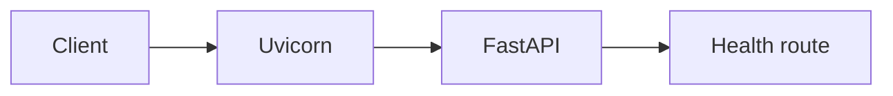

#### Verification and evidence
- `python --version`: Python 3.12.0.
- `py --version`: Python 3.12.0.
- `.\.venv\Scripts\python.exe -m pip install -e ".[dev]"`: succeeded.
- `.\.venv\Scripts\python.exe -m ruff check .`: passed.
- `.\.venv\Scripts\python.exe -m ruff format --check .`: passed after formatting.
- `.\.venv\Scripts\python.exe -m pytest -q`: `1 passed`, with two dependency deprecation warnings from FastAPI/Starlette test client internals.
- Live Uvicorn smoke check: `StatusCode=200`, body `{"status":"ok"}`.

#### Known limitations after this day
No auth, task CRUD, database, readiness/dependency health, TLS profile, or CI existed. The test client emitted dependency deprecation warnings that did not fail Day 1.

#### Related decisions and next design step
No ADRs. Next design step was Day 2 route and contract design.

### Day 2 - W1.2: Routing and API contracts
- Calendar date(s): 2026-09-09
- Status: Completed

#### What changed
Added resource-style project/task CRUD under `/api/v1`, initial Pydantic models, in-memory storage, bounded list endpoints, create `Location` headers, JSON error-envelope handlers, and HTTP contract tests.

#### Why the design changed
The project needed a first resource API with explicit HTTP semantics before introducing validation depth, persistence, authentication, or authorization. In-memory storage kept the Day 2 focus on route contracts instead of database behavior.

#### Boundary placement and ownership
`src/taskforge/api.py` owned route shape, method choice, status codes, and dependency access to the store. `src/taskforge/store.py` owned temporary object storage. `src/taskforge/models.py` owned the initial body schemas. `src/taskforge/main.py` owned app construction, health, router inclusion, and exception mapping.

#### API, data, and compatibility impact
Added project routes at `/api/v1/projects` and nested task routes at `/api/v1/projects/{project_id}/tasks`. Chose `PATCH` for partial updates. List endpoints accept `page_size` from 1 through 100. Expected errors are wrapped under an `error` key.

#### Request / job flow
A request entered FastAPI, matched a `/api/v1` route, validated path/query/body inputs, called the route handler, read or mutated `InMemoryStore`, and returned a JSON response. Jobs were not applicable.

```mermaid
flowchart LR
    Client[Client] --> API[FastAPI]
    API --> Route[/api/v1 route]
    Route --> Store[InMemoryStore]
    Store --> Route
```

#### Verification and evidence
- `.\.venv\Scripts\python.exe -m ruff check .`: passed.
- `.\.venv\Scripts\python.exe -m ruff format --check .`: passed.
- `.\.venv\Scripts\python.exe -m pytest -q`: `8 passed`, with two dependency deprecation warnings.
- Earlier failure: wrong-method 405 responses did not use the envelope because they came from Starlette's exception type. Fixed by handling `StarletteHTTPException`.

#### Known limitations after this day
Data was not durable. There was no auth, tenant isolation, database transaction, concurrency control, or persistence guarantee.

#### Related decisions and next design step
No ADRs. Next design step was Day 3 validation boundaries.

### Day 3 - W1.3: Serialization and validation
- Calendar date(s): 2026-09-09
- Status: Completed

#### What changed
Tightened request/response models, rejected unknown fields, parsed path IDs as UUIDs, clarified missing versus null PATCH behavior, rejected empty task PATCH bodies, added a domain rule for task status transitions, and added validation-focused tests.

#### Why the design changed
Day 2 proved route contracts, but the API still accepted some inputs too loosely. Day 3 made the boundary explicit so client mistakes are visible instead of silently ignored.

#### Boundary placement and ownership
Pydantic request models owned field shape, length, enum, extra-field, and empty-update validation. FastAPI path annotations owned UUID parsing. The in-memory store temporarily owned the task state-transition rule because no service layer existed yet. Routes translated store/domain failures into HTTP status codes.

#### API, data, and compatibility impact
Malformed UUID path IDs return `422` before store lookup. Valid UUIDs that are not present return `404`. Unknown request fields return `422` instead of being ignored. Direct `todo` to `done` task updates return `409 invalid_state_transition`.

#### Request / job flow
A request entered FastAPI, parsed JSON and UUID path parameters, validated the Pydantic request model, called the route, applied store/domain rules, and serialized through response models. Jobs were not applicable.

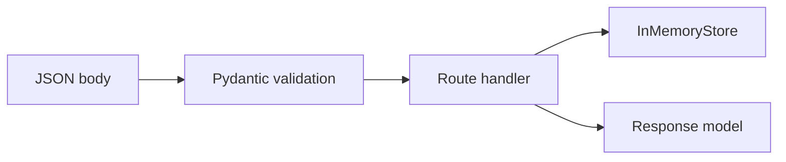

#### Verification and evidence
- Initial Day 3 validation tests failed for unknown fields, status transition, and invalid UUID handling. A later explicit-null test exposed that validation details containing raw `ValueError` objects must be JSON-encoded before returning them.
- `.\.venv\Scripts\python.exe -m ruff check .`: passed.
- `.\.venv\Scripts\python.exe -m ruff format --check .`: passed.
- `.\.venv\Scripts\python.exe -m pytest -q`: `18 passed`, with two dependency deprecation warnings.

#### Known limitations after this day
No global request body byte limit was implemented. No auth-sensitive response fields existed. Domain rules still lived close to the in-memory store and needed to move into a service layer on Day 4.

#### Related decisions and next design step
No ADRs. Next design step was Day 4 layer separation.

### Day 4 - W1.4: Layers and configuration
- Calendar date(s): 2026-09-09
- Status: Completed

#### What changed
Added `TaskForgeService`, application error classes, service tests, request ID middleware, structured access logs, startup settings validation, and config/middleware tests. Moved the task status-transition business rule out of storage and into the service layer.

#### Why the design changed
The code needed clearer ownership before database persistence and authorization arrive. Service methods give business rules a reusable home outside HTTP handlers and keep storage focused on data access.

#### Boundary placement and ownership
Routes own HTTP parsing results, response headers, status codes, and service-error mapping. `TaskForgeService` owns business rules and application-level missing-resource behavior. `InMemoryStore` owns mechanical reads/writes only. Exception handlers own public error envelopes. Middleware owns request IDs and access logging. `Settings` owns startup configuration validation.

#### API, data, and compatibility impact
No intentional endpoint shape change. Responses now include `X-Request-ID`. Access logs contain method, path, status code, duration, and request ID. Invalid startup environment/log-level values prevent app construction.

#### Request / job flow
A request enters middleware, receives or preserves a request ID, passes through FastAPI validation and route handling, calls the service, uses the store for temporary data, returns a response, adds `X-Request-ID`, and writes a structured log record. Jobs are not applicable.

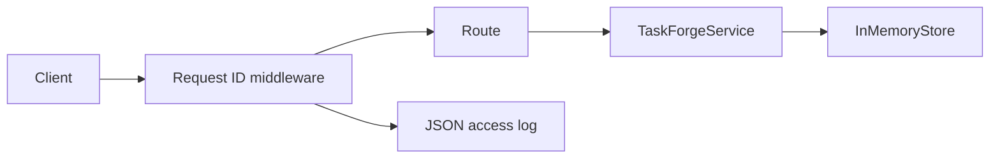

#### Verification and evidence
- `.\.venv\Scripts\python.exe -m ruff check .`: passed.
- `.\.venv\Scripts\python.exe -m ruff format --check .`: passed.
- `.\.venv\Scripts\python.exe -m pytest -q`: `25 passed`, with two dependency deprecation warnings.
- `tests/test_services.py` verifies service ownership of the transition rule and store pass-through behavior.
- `tests/test_app_boundaries.py` verifies invalid config failure, request ID behavior, and structured logs without request bodies.

#### Known limitations after this day
Logging has not been inspected manually in a live Uvicorn terminal. There is still no database-backed repository, auth, tenant isolation, global payload byte-size limit, or CI.

#### Related decisions and next design step
Related: ADR-001 in `docs/decisions.md`. Next design step is Day 5: relational modeling, SQL constraints, and local PostgreSQL setup.

### Day 5 - W1.5: Relational modeling and SQL
- Calendar date(s): 2026-09-10
- Status: Completed

#### What changed
Added local PostgreSQL Compose setup on host port `5433`, initial SQL schema, seed data, SQL validation scripts, relational model documentation, and ADR-002. The API still uses the in-memory store; Day 5 is the modeling and database constraint lab.

#### Why the design changed
TaskForge needs durable integrity rules before the API is wired to PostgreSQL. Database constraints protect data written by any path, not just today's FastAPI handlers.

#### Boundary placement and ownership
`db/schema.sql` owns the planned relational structure and database-level constraints. `db/seed.sql` owns synthetic seed data. `tests/sql/constraints.sql` owns database integrity evidence. `tests/sql/queries.sql` owns join/query evidence. Runtime reads/writes still go through `InMemoryStore` until Day 6.

#### API, data, and compatibility impact
No runtime API behavior changed. The planned durable model includes users, workspaces, memberships, projects, and tasks. Tasks belong to workspaces through projects, so authorized task lookup joins memberships, projects, and tasks.

#### Request / job flow
Runtime request flow is unchanged from Day 4. Database validation flow is manual/lab-only: SQL files are copied into the PostgreSQL container and run with `psql`, then rolled back.

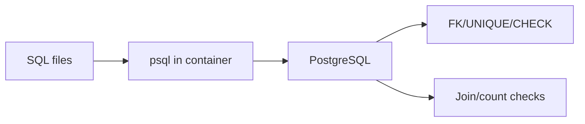

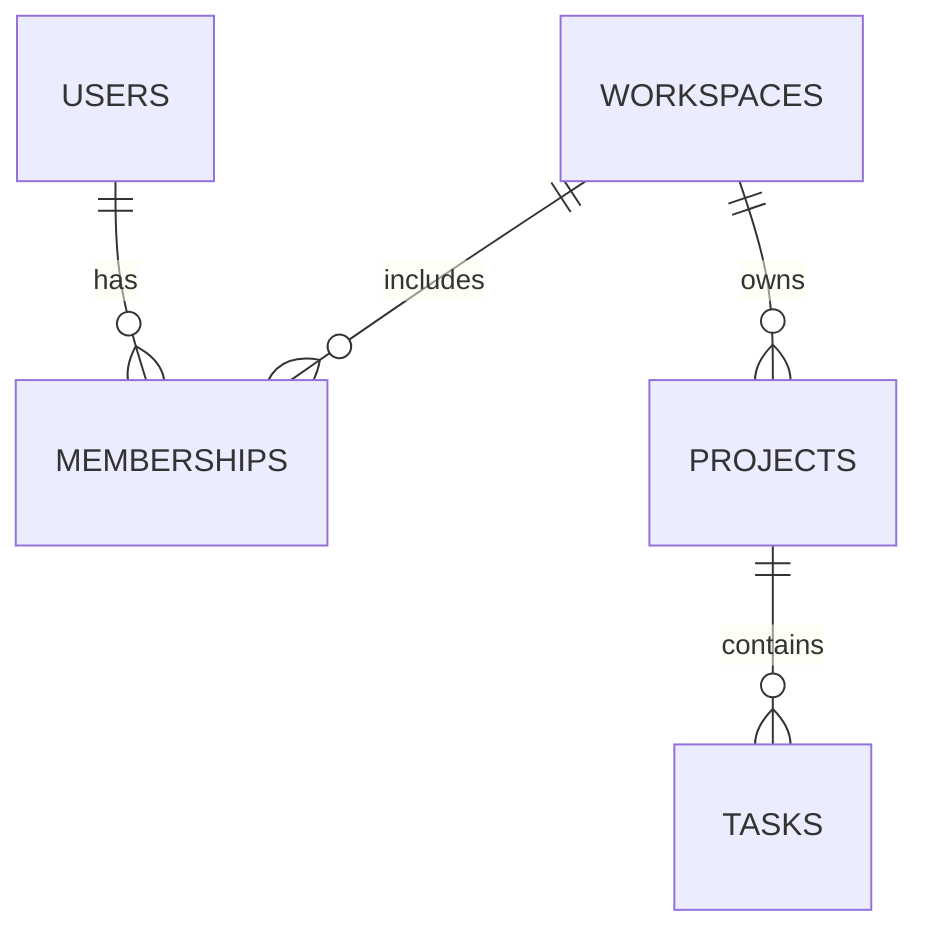

#### Verification and evidence
- Docker version: 28.0.4.
- Docker Compose version: v2.34.0-desktop.1.
- First `docker compose up -d postgres` timed out; retry revealed host port `5432` was allocated.
- Updated `compose.yaml` to map host `5433` to container `5432`.
- `docker compose up -d postgres`: succeeded.
- Container health: `healthy`.
- `psql -f tests/sql/constraints.sql`: passed and rolled back.
- `psql -f tests/sql/queries.sql`: passed and rolled back.
- `.\.venv\Scripts\python.exe -m ruff check .`: passed.
- `.\.venv\Scripts\python.exe -m ruff format --check .`: passed.
- `.\.venv\Scripts\python.exe -m pytest -q`: `25 passed`, with two dependency deprecation warnings.

#### Known limitations after this day
The API does not use PostgreSQL yet. There is no Alembic migration environment, upgrade path, request-scoped session, repository implementation, or integration test database isolation yet. Index design beyond implicit primary/unique indexes is deferred.

#### Related decisions and next design step
Related: ADR-002 in `docs/decisions.md`. Next design step is Day 6: persistence and migrations.


### Day 6 - W1.6: Persistence and migrations
- Calendar date(s): 2026-09-10
- Status: Completed

#### What changed
Added SQLAlchemy/psycopg dependencies, Alembic migration tooling, ORM mappings, a PostgreSQL repository, request-scoped database sessions, finite pool settings, isolated PostgreSQL integration tests, and PostgreSQL as the default runtime storage backend. Memory storage remains available for focused tests.

#### Why the design changed
The API needed durable CRUD behavior. Process memory could prove route contracts, but it could not survive restart, enforce database transactions, or prepare for authorization and background work.

#### Boundary placement and ownership
`src/taskforge/main.py` owns app construction, engine creation, pool settings, and lifespan disposal. `src/taskforge/api.py` owns the request-scoped session dependency: create service/repository, commit after success, rollback on exception, close the session. `src/taskforge/services.py` owns business rules and depends on a store protocol. `src/taskforge/repositories.py` owns SQL data access and uses `flush()` without committing. `migrations/` owns schema changes; requests do not run migrations.

#### API, data, and compatibility impact
Endpoint shapes did not intentionally change. With `TASKFORGE_STORAGE_BACKEND=postgres`, project/task data is durable and survives a new app instance. The unauthenticated development API writes projects into a configured default workspace. Existing API tests explicitly use the memory backend so they stay focused on contract behavior.

#### Request / job flow
A PostgreSQL-backed request enters middleware, passes FastAPI validation, opens a request-scoped SQLAlchemy session, builds a service with `PostgresStore`, executes repository SQL, commits after the handler succeeds, rolls back on exception, closes the session, and returns/logs the response. Jobs are not applicable yet.

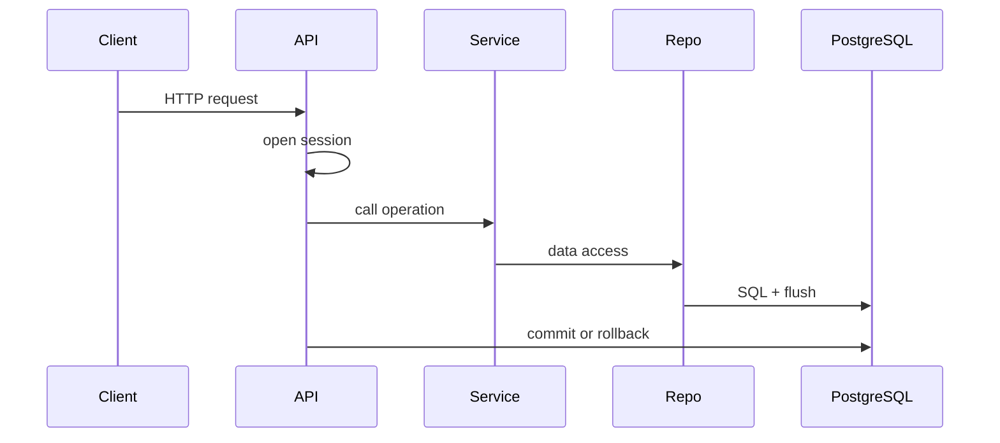

#### Verification and evidence
- `.\.venv\Scripts\python.exe -m pip install -e ".[dev]"`: installed Alembic, SQLAlchemy, and psycopg dependencies.
- `.\.venv\Scripts\python.exe -m ruff check .`: passed.
- `.\.venv\Scripts\python.exe -m ruff format --check .`: passed.
- `.\.venv\Scripts\python.exe -m pytest -q`: `28 passed`, with two dependency deprecation warnings.
- `tests/test_postgres_persistence.py` creates/drops isolated PostgreSQL databases, runs Alembic migrations, verifies persisted data across app instances, and verifies rollback removes uncommitted multi-step work. Manual API testing also verified that a created project still appears after stopping and restarting Uvicorn.

#### Known limitations after this day
Authentication and real workspace authorization are still absent. The default workspace is a local development bridge, not a security model. The existing developer `taskforge` database may contain Day 5 manual schema without Alembic version state; use a fresh database or deliberate migration stamping before treating that database as migrated. N+1 query behavior has not been measured.

#### Related decisions and next design step
Related: ADR-003 in `docs/decisions.md`. Learner explained total pool demand across worker processes. Next design step is Day 7 foundation review.

### Day 7 - W1.7: Foundation review
- Calendar date(s): 2026-09-11
- Status: Completed

#### What changed
Added optional `name_contains` filtering to `GET /api/v1/projects`, with case-insensitive substring matching in both the memory test store and PostgreSQL repository. Added memory-backed HTTP tests and PostgreSQL integration tests for filter behavior and page-size interaction.

#### Why the design changed
The review implementation task checks whether Week 1 boundaries are understood well enough to make a small feature pass through route, service, repository, and tests without breaking existing contracts.

#### Boundary placement and ownership
`src/taskforge/api.py` owns the query parameter contract. `src/taskforge/services.py` forwards the filter through the store protocol. `src/taskforge/store.py` implements in-memory filtering for focused tests. `src/taskforge/repositories.py` implements SQL filtering with case-insensitive matching. Tests verify both memory-backed HTTP behavior and real PostgreSQL repository behavior.

#### API, data, and compatibility impact
`GET /api/v1/projects` remains backward compatible. `name_contains` is optional, rejects an empty value through query validation, filters case-insensitively, and still applies `page_size` after filtering.

#### Request / job flow
Project list requests now optionally include a filter before ordering/limiting results. Jobs are not applicable.

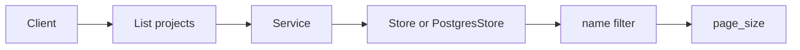

#### Verification and evidence
- Learner debugged the broken `COUNT(*)` with `LEFT JOIN` query and corrected it to `COUNT(t.id)` with explicit grouping.
- `.\.venv\Scripts\python.exe -m ruff check .`: passed.
- `.\.venv\Scripts\python.exe -m ruff format --check .`: passed.
- `.\.venv\Scripts\python.exe -m pytest -q`: `34 passed`, with two dependency warnings.
- Fresh-start rehearsal in `C:\tmp\taskforge-fresh-20260911`: clean venv creation succeeded, editable install succeeded, ruff check passed, format check passed, and pytest passed with `34 passed`.

#### Known limitations after this day
Fresh-start rehearsal used a clean local copy rather than a separate remote clone. Authentication and real workspace authorization remain future work.

#### Related decisions and next design step
Related: ADR-004 records PostgreSQL as the Week 1 runtime source of truth. Next design step is Day 8 authentication and sessions.

### Day 8 - W2.1: Authentication and sessions
- Calendar date(s): 2026-09-11
- Status: Completed

#### What changed
Added a sessions table migration, password/token security helpers, auth request/response models, `AuthRepository`, `AuthService`, and auth routes for registration, login, logout, and `/me`. Shared PostgreSQL integration-test fixture setup moved to `tests/conftest.py`. Unsafe project/task mutations now require a valid CSRF header when a session cookie is present.

#### Why the design changed
Week 2 needs a durable identity boundary before authorization can be enforced. Server-side session rows allow expiry and revocation instead of trusting a self-contained client token.

#### Boundary placement and ownership
`src/taskforge/security.py` owns password hashing and high-entropy token generation/hash helpers. `src/taskforge/auth_repository.py` owns database access for users and sessions. `src/taskforge/auth_service.py` owns registration, login credential verification, session issuance, logout, current-user lookup, and CSRF token validation. `src/taskforge/api.py` owns HTTP cookies, auth route contracts, and HTTP error mapping.

#### API, data, and compatibility impact
Added `/api/v1/auth/register`, `/api/v1/auth/login`, `/api/v1/auth/logout`, and `/api/v1/auth/me`. Login sets an HttpOnly SameSite=Lax session cookie and returns a CSRF token. The database schema now has `sessions` with hashed session/CSRF tokens, expiry, revocation, and a user foreign key. Project/task routes remain backward compatible for unauthenticated local development, but if a session cookie is present on unsafe mutations, CSRF is required.

#### Request / job flow
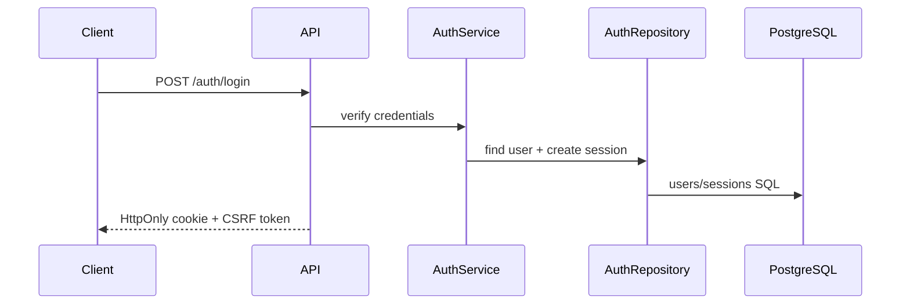

#### Verification and evidence
- `.\.venv\Scripts\python.exe -m pytest -q tests\test_security.py tests\test_auth_repository.py tests\test_auth_api.py`: `14 passed`, with two dependency warnings.
- `.\.venv\Scripts\python.exe -m ruff check .`: passed.
- `.\.venv\Scripts\python.exe -m pytest -q`: `48 passed`, with two dependency warnings.

#### Known limitations after this day
Authentication proves identity, but project/task routes are not yet authorization-scoped to memberships or workspaces. Local HTTP uses `TASKFORGE_SESSION_COOKIE_SECURE=false`; production HTTPS must set Secure cookies. Login throttling and tenant authorization are future modules.

#### Related decisions and next design step
Related: ADR-005 records opaque PostgreSQL-backed sessions. Next design step is Day 9 authorization and tenant isolation.


### Day 9 - W2.2: Authorization and tenant isolation
- Calendar date(s): 2026-09-13 to 2026-09-14
- Status: Completed

#### What changed
Added `AuthorizationRepository` and `AuthorizationService` for authenticated workspace/project/task operations. Added workspace-scoped project read, update, and delete routes under `/api/v1/workspaces/{workspace_id}/projects/{project_id}`. Added workspace-scoped task create, list, read, update, and delete routes under `/api/v1/workspaces/{workspace_id}/projects/{project_id}/tasks`. Added membership add/list/update/delete routes under `/api/v1/workspaces/{workspace_id}/memberships`. Added tests for owner success, outsider `404`, member/admin/owner role behavior, duplicate membership `409`, last-owner protection, member project-delete `403`, and task parent-child swap protection.

#### Why the design changed
Authentication only proves who the requester is. Day 9 binds data access to workspace membership so users cannot read or mutate another tenant's memberships, projects, or tasks by guessing IDs.

#### Boundary placement and ownership
`src/taskforge/api.py` owns authenticated route dependencies, CSRF for unsafe methods, and HTTP mapping. `src/taskforge/authorization_service.py` owns authorization outcomes: invisible/not found versus forbidden. `src/taskforge/authorization_repository.py` owns membership-scoped SQL lookups, task parent-child checks, role checks, duplicate checks, and last-owner checks. Legacy `/api/v1/projects` routes still use `TaskForgeService` and are not the final multi-user authorization surface.

#### API, data, and compatibility impact
Added authenticated workspace membership, project, and task routes. Cross-tenant or nonexistent membership/project/task access returns `404`. In-tenant role denial returns `403`. Duplicate membership and last-owner violations return `409`. Existing legacy project/task routes remain present for now.

#### Request / job flow
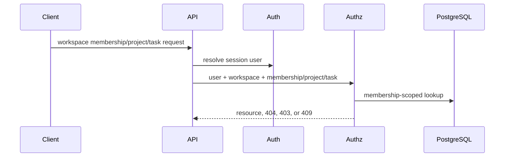

#### Verification and evidence
- `\.venv\Scripts\python.exe -m pytest -q tests\test_authorization.py`: `27 passed`, with two dependency warnings.
- `\.venv\Scripts\python.exe -m ruff check .`: passed.
- `\.venv\Scripts\python.exe -m ruff format --check .`: passed.
- `\.venv\Scripts\python.exe -m pytest -q`: `75 passed`, with two dependency warnings.

#### Known limitations after this day
Legacy unauthenticated project/task routes still exist and must be reconciled later in Week 2.

#### Related decisions and next design step
Related: ADR-006. Next design step is reconciliation of the legacy unauthenticated project/task route surface.


### Day 10 - W2.3: Transactions and concurrent writes
- Calendar date(s): 2026-09-14
- Status: Completed

#### What changed
Added task row versions and an `audit_events` table through Alembic migration `0003_task_versions_audit_events`. `TaskRead` now exposes `version`, and `TaskUpdate` requires `expected_version`. Legacy and workspace-scoped task update repositories now update only when the stored row version matches the caller's expected version, increment the version on success, and write a task audit event in the same transaction.

#### Why the design changed
A transaction makes each request atomic, but it does not know whether the client edited a stale snapshot. Version-checked writes prevent the second writer from silently overwriting a newer committed task update.

#### Boundary placement and ownership
The API owns the public PATCH contract and maps stale updates to `409 Conflict`. Services own the stale-version domain outcome and keep the existing status-transition rule. Repositories own the conditional SQL update and audit-event insert. PostgreSQL owns durable version and audit rows. The request-scoped session still owns the final commit or rollback.

#### API, data, and compatibility impact
Task PATCH bodies now require `expected_version` with a positive integer. Successful task updates return the next task `version`. Stale versions return `409 stale_task_version`. Older clients that omit `expected_version` receive validation errors. The schema adds `tasks.version` and `audit_events`.

#### Request / job flow
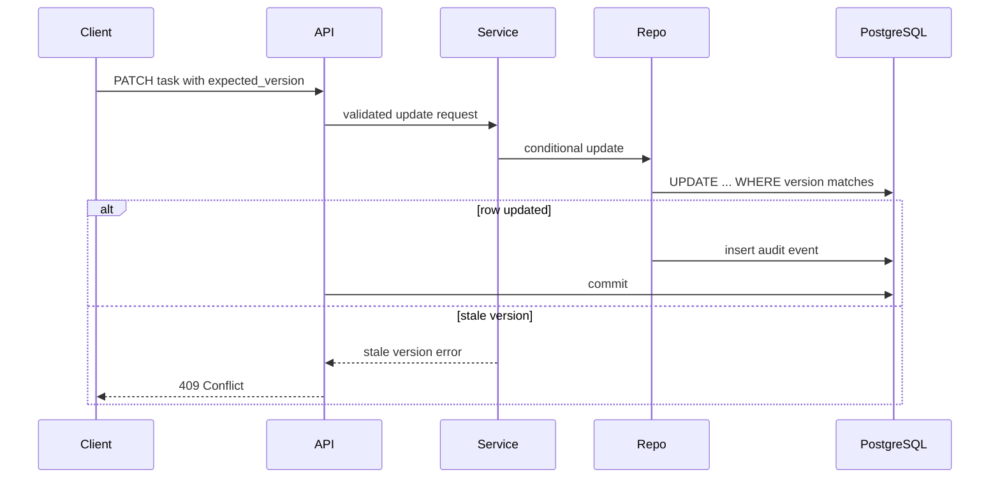

#### Verification and evidence
- Focused ruff check on changed files: passed.
- Focused pytest for services, validation, project/task routes, authorization, and PostgreSQL persistence: `59 passed`, with two dependency warnings.
- `./.venv/Scripts/python.exe -m ruff check .`: passed.
- `./.venv/Scripts/python.exe -m ruff format --check .`: `41 files already formatted`.
- `./.venv/Scripts/python.exe -m pytest -q`: `78 passed`, with two dependency warnings.

#### Known limitations after this day
No high-contention load test, explicit deadlock exercise, or HTTP ETag/If-Match contract was implemented. Audit events currently record task update versions only, not a full before/after field diff.

#### Related decisions and next design step
Related: ADR-007. Next design step is Day 11 query-plan and index work.
### Day 11 - W2.4: Indexes and query performance
- Calendar date(s): 2026-09-14
- Status: Completed

#### What changed
Added deterministic task list ordering by `(created_at, id)`, optional cursor parameters `after_created_at` and `after_id`, validation that both cursor parts are supplied together, matching memory and PostgreSQL cursor behavior, and Alembic migration `0004_add_task_list_cursor_index.py` for `ix_tasks_project_created_at_id` on `(project_id, created_at, id)`.

#### Why the design changed
Task lists were ordered only by `created_at`, which is not unique. Offset pagination also gets more expensive on deeper pages because the database still walks skipped rows. Cursor pagination plus a composite index gives TaskForge a stable next-page contract that matches the measured query shape.

#### Boundary placement and ownership
`src/taskforge/api.py` owns cursor query-parameter validation. Services pass cursor values through without deciding SQL shape. `src/taskforge/repositories.py` and `src/taskforge/authorization_repository.py` own the tuple cursor predicate and deterministic ordering. PostgreSQL owns the composite index. `src/taskforge/store.py` mirrors the behavior for focused memory tests.

#### API, data, and compatibility impact
Task list endpoints still accept `page_size`. They now also accept `after_created_at` and `after_id`; supplying only one cursor part returns `422 validation_error`. Existing clients that omit cursor parameters still get the first page. The schema adds index `ix_tasks_project_created_at_id`.

#### Request / job flow
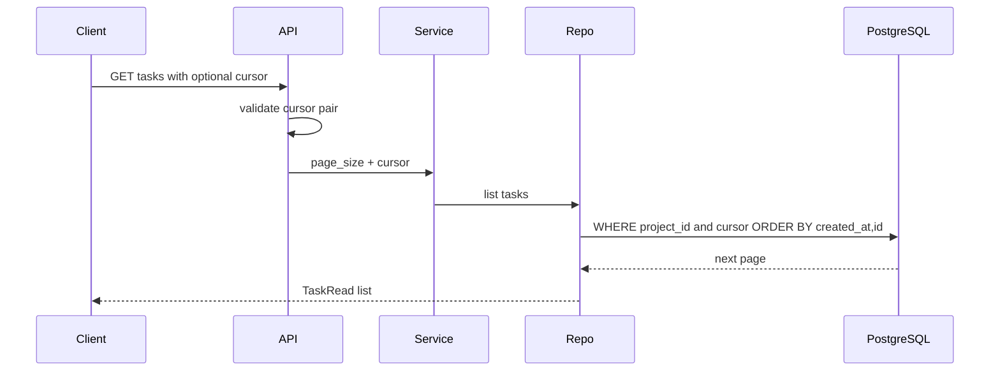

#### Verification and evidence
- Focused pytest for PostgreSQL persistence, project/task routes, authorization, and services: `50 passed`, with two dependency warnings.
- Full pytest: `79 passed`, with two dependency warnings.
- Ruff check and format check passed.
- Disposable `taskforge_day11` database seeded with 10,000 tasks.
- First-page plan used `ix_tasks_project_created_at_id`, no `Sort`, returned 20 rows, hit 3 shared buffers, execution about 0.239 ms.
- Cursor plan used the same index with `ROW(created_at, id) > ROW(...)`, returned 20 rows, hit 3 shared buffers, execution about 0.244 ms.
- `LIMIT 20 OFFSET 5000` used the same index but scanned 5,020 rows, hit 101 shared buffers, execution about 2.960 ms.

#### Known limitations after this day
The cursor is explicit query parameters rather than an opaque encoded token. Only task list ordering is covered; project lists and membership lists still use simple first-page pagination. Concurrent inserts can change later pages around a cursor, which is normal for this contract and must be documented for clients.

#### Related decisions and next design step
Related: ADR-008. Next design step is Day 12 cache correctness and freshness policy.

### Day 12 - W2.5: Cache correctness
- Calendar date(s): 2026-09-16
- Status: Completed

#### What changed
Added a Redis-backed cache-aside path for authorized workspace project summaries. The new summary endpoint returns a project summary after proving the caller can access the workspace/project. Added cache key construction, Redis and null cache implementations, graceful Redis failure handling, after-commit cache-delete scheduling, Redis settings, Compose Redis service configuration, and cache/authorization tests.

#### Why the design changed
Project summaries are derived read data. Repeated reads should not always recompute the same aggregate from PostgreSQL once the API has a clear freshness policy. The design needed to make tenant isolation, source-of-truth ownership, invalidation timing, and Redis outage behavior explicit before caching protected data.

#### Boundary placement and ownership
`src/taskforge/authorization_service.py` owns the authorization-before-cache flow. `src/taskforge/authorization_repository.py` owns the authoritative PostgreSQL summary query. `src/taskforge/cache.py` owns cache key shape, Redis/no-op adapter behavior, TTL writes, Redis failure fallback, and post-commit invalidation helpers. `src/taskforge/api.py` owns request transaction completion and runs scheduled cache deletes only after a successful commit. `src/taskforge/main.py` owns Redis client lifecycle.

#### API, data, and compatibility impact
Added an authenticated project summary read under `/api/v1/workspaces/{workspace_id}/projects/{project_id}/summary`. The response shape is represented by `ProjectSummaryRead`. No PostgreSQL migration was needed because the summary is derived from existing projects and tasks. `compose.yaml` now includes Redis for local cache testing, and settings include Redis URL, timeout, and summary TTL.

#### Request / job flow
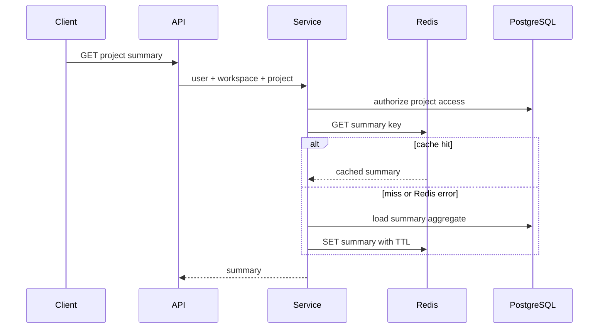

Writes that affect task counts still commit PostgreSQL first. After commit, the request dependency deletes the affected Redis key. Failed Redis deletes do not roll back the database write.

#### Verification and evidence
- Focused `tests/test_cache.py` and `tests/test_authorization.py` passed with `39 passed` and two dependency warnings.
- `ruff check .` passed.
- Learner reported the full test suite and format check passed.
- Manual Redis check through Docker Compose returned `PONG`.

#### Known limitations after this day
The cache is eventually consistent and can briefly serve stale data. TTL is the safety bound for failed invalidation and stale-fill races; it is not strict read-after-write consistency. There is no stampede protection, no hot-key load test, no production Redis readiness check, and no broader cached read-model strategy yet.

#### Related decisions and next design step
Related: ADR-009. Next design step is Day 13 resource limits and abuse-resistant request behavior.
### Day 13 - W2.6: Security and resource limits
- Calendar date(s): 2026-09-16
- Status: Completed

#### What changed
Added a Redis-backed atomic rate limiter and wired it into the FastAPI app state. Added login limiting before password verification, authenticated workspace write limiting after current-user resolution, and selected expensive authenticated read limiting for task lists and project summaries. Added tests for core limiter behavior, login `429`, write `429`, read `429`, outage policy, and `Retry-After` preservation.

#### Why the design changed
TaskForge already had authentication, authorization, tenant isolation, PostgreSQL persistence, and Redis. It still needed a shared way to limit abusive or accidental request volume across API workers. Process-local counters would not coordinate across workers, and PostgreSQL should not be the first choice for disposable high-churn counters.

#### Boundary placement and ownership
`src/taskforge/rate_limit.py` owns atomic Redis counter behavior through one Lua script. `src/taskforge/main.py` owns limiter construction and uses `NullRateLimiter` under test settings. `src/taskforge/api.py` owns route-level policy: login limit by IP plus email, authenticated writes by user ID, and selected expensive reads by user ID. Authentication and authorization remain separate and are not replaced by rate limits.

#### API, data, and compatibility impact
Rate-limited routes can now return `429 rate_limited` with `Retry-After`. Login is limited to 5 attempts per 60 seconds for an IP/email key and fails closed if Redis is unavailable. Authenticated workspace writes are limited to 60 per 60 seconds per user and fail open during Redis outages. Task list and project summary reads are limited to 30 per 60 seconds per user and fail open during Redis outages.

#### Request / job flow
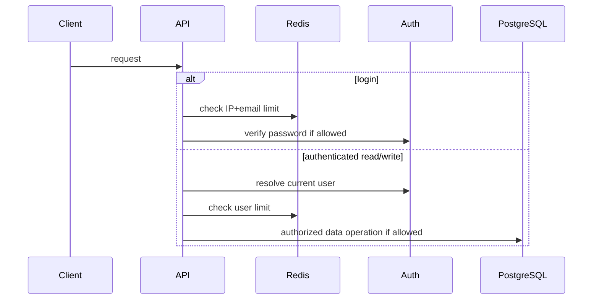

#### Verification and evidence
- `\.venv\Scripts\python.exe -m ruff check .`: passed.
- `\.venv\Scripts\python.exe -m pytest -q tests`: `99 passed`, with two dependency deprecation warnings.
- Focused tests cover atomic script usage, fail-open/fail-closed behavior, login/write/read `429` responses, and `Retry-After` headers.

#### Known limitations after this day
Rate-limit numbers are initial policy choices, not measured capacity limits. Client IP uses `request.client.host`; trusted proxy and forwarded-header handling are not designed yet. Global request body byte-size limits are still not implemented. Rate-limit metrics and live multi-worker Redis testing are deferred.

#### Related decisions and next design step
Related: ADR-010. Next design step is Day 14 correctness review and scenario pack.
### Day 14 - W2.7: Correctness review
- Calendar date(s): 2026-09-17
- Status: Completed

#### What changed
Added a Week 2 correctness review package and one missing resource-boundary guard. `docs/week2-correctness-review.md` maps the scenario pack to existing tests, compares route behavior to the permission matrix, records Day 11 query-plan evidence, and states where session, durable, cached, and rate-limit state live. `docs/threat-model.md` records current assets, trust boundaries, threats, controls, and open risks. `docs/cache-policy.md` records cache-aside read behavior, tenant-scoped keying, invalidation, TTL, outage behavior, and security rules. Runtime code gained `Settings.max_request_body_bytes` and middleware in `src/taskforge/main.py` that returns 413 when `Content-Length` exceeds the configured limit.

#### Why the design changed
Week 2 introduced several separate protections: sessions, workspace authorization, optimistic concurrency, cursor/index work, Redis cache, rate limits, and input validation. Day 14 reconciles them into a single correctness picture and fills the missing oversized-input scenario from the roadmap.

#### Boundary placement and ownership
`src/taskforge/main.py` owns process-wide HTTP middleware concerns: request IDs, structured access logs, exception envelopes, and now coarse request body length rejection. `src/taskforge/config.py` owns the configured limit. Route handlers and services still own request schema, authentication, authorization, transactions, cache access, and rate-limit calls. PostgreSQL remains authoritative durable state; Redis remains disposable cache/control state.

#### API, data, and compatibility impact
Requests with `Content-Length` greater than `Settings.max_request_body_bytes` now receive `413` with error code `request_body_too_large`. No schema migration was required. The default limit is 1,000,000 bytes. Existing normal JSON requests remain compatible.

#### Request / job flow
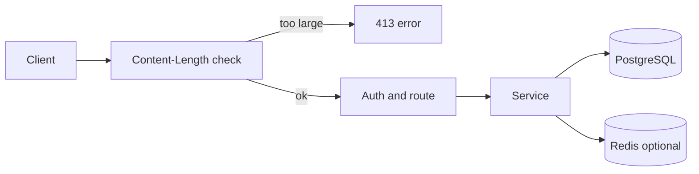

#### Verification and evidence
Focused validation passed: `\.venv\Scripts\python.exe -m ruff check .`; `\.venv\Scripts\python.exe -m pytest -q tests\test_app_boundaries.py tests\test_validation.py` returned 15 passed with two dependency deprecation warnings. Scenario evidence is listed in `docs/week2-correctness-review.md`. Full regression passed: `\.venv\Scripts\python.exe -m ruff check .`; `\.venv\Scripts\python.exe -m ruff format --check .`; `\.venv\Scripts\python.exe -m pytest -q tests` returned 100 passed with two dependency deprecation warnings.

#### Known limitations after this day
The body-size guard relies on `Content-Length`; it does not yet enforce a limit while streaming/chunking a body without that header. The query-plan report uses Day 11 measured evidence rather than a fresh Day 14 run. Rate-limit values remain starting policy choices, not measured capacity limits.

#### Related decisions and next design step
Related: ADR-005 through ADR-010. No new ADR was created because Day 14 mostly reviewed and documented existing decisions plus a small resource limit. Next design step is Day 15 / W3.1 durable background jobs.

### Day 15 - W3.1: Durable background jobs
- Calendar date(s): 2026-09-22
- Status: Completed

#### What changed
Added migration `0005_add_exports_and_jobs`, ORM rows for `jobs` and `exports`, the `ExportService` and repository in `src/taskforge/jobs.py`, tenant-scoped export routes, and a one-worker CSV processor. `POST /api/v1/workspaces/{workspace_id}/exports` creates both pending records in one PostgreSQL transaction and returns `202` with a status URL only after the request dependency commits. `GET /api/v1/exports/{export_id}` returns status only when the current user belongs to the export's workspace.

#### Why the design changed
Exports can outlive an HTTP request and must survive an API restart. PostgreSQL is already TaskForge's durable authority, so the first job implementation uses a database job row instead of introducing a broker. The export is kept as the user-facing resource while the job records execution state.

#### Boundary placement and ownership
`src/taskforge/api.py` owns HTTP status, CSRF, rate limits, and dependency transaction boundaries. `src/taskforge/jobs.py` owns export authorization through membership-scoped queries, job/export state transitions, CSV generation, and sanitized terminal errors. PostgreSQL owns accepted work and status. The current worker owns output generation and terminal updates; no lease or retry owner exists yet.

#### API, data, and compatibility impact
Added `POST /api/v1/workspaces/{workspace_id}/exports` with `202 Accepted` and `Location`, plus `GET /api/v1/exports/{export_id}`. Migration `0005` adds `jobs` and `exports`, with foreign keys, status checks, and a workspace/created-at index. The default local output directory is `.dist/exports`; the status response exposes a relative output reference, not an absolute server path. A download endpoint is not implemented.

#### Request / job flow
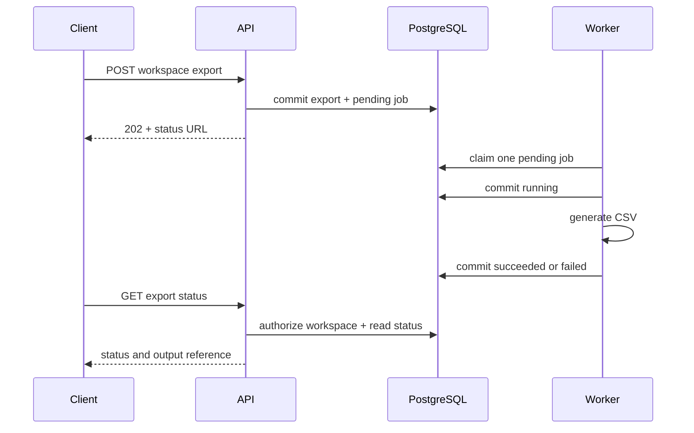

#### Verification and evidence
- `\.venv\Scripts\python.exe -m pytest -q tests\test_jobs.py`: `4 passed`.
- `\.venv\Scripts\python.exe -m pytest -q tests`: `104 passed`, with two dependency deprecation warnings.
- `\.venv\Scripts\python.exe -m ruff check .`: passed.
- `\.venv\Scripts\python.exe -m ruff format --check .`: 45 files already formatted.
- Tests cover atomic export/job persistence, tenant isolation, successful CSV generation, and terminal failure recording.

#### Known limitations after this day
The worker uses find-then-claim and is intentionally limited to one worker. A crash after claim can leave a job `running` indefinitely. There are no leases, ownership tokens, bounded retries, idempotency keys, crash-safe output finalization, or secure file download. Duplicate status fields are updated together by this implementation but need stronger conditional ownership semantics in Day 16.

#### Related decisions and next design step
No new ADR was created; PostgreSQL jobs were already the roadmap's selected execution mechanism. Next design step is Day 16 / W3.2: atomic claims with `FOR UPDATE SKIP LOCKED`, lease ownership, conditional completion, and bounded concurrency.

### Day 16 - W3.2: Concurrency and lifecycle ownership
- Calendar date(s): 2026-09-22
- Status: Completed

#### What changed
Added migration `0006_add_job_leases` with `owner_token` and `lease_expires_at`, atomic PostgreSQL claims using `FOR UPDATE SKIP LOCKED`, lease renewal through a separate session, conditional success/failure updates, and configured bounded worker concurrency. The worker now reclaims pending or expired jobs, starts a lease heartbeat while CSV generation runs, and refuses stale-owner completion.

#### Why the design changed
Day 15's find-then-claim path could allow duplicate claims when multiple workers ran. A database row lock coordinates separate worker processes, while a lease provides a bounded ownership interval for workers that crash or lose connectivity. Slow CSV generation must remain outside the claim transaction.

#### Boundary placement and ownership
`ExportRepository.claim_one` owns the short claim transaction and token assignment. `renew_lease` owns conditional lease extension. `complete` and `fail` own conditional terminal transitions for the current token. `run_one_export` owns the work/heartbeat lifecycle. `worker.py` owns the bounded thread pool; each task gets its own SQLAlchemy session. PostgreSQL remains the authority for ownership; process-local thread state only controls local concurrency.

#### API, data, and compatibility impact
No new public endpoint was added. Existing export status responses now reflect jobs that may be reclaimed after lease expiry. Settings add `TASKFORGE_JOB_LEASE_SECONDS` and `TASKFORGE_WORKER_CONCURRENCY`. Migration `0006` adds the lease index and nullable ownership fields, preserving existing pending/succeeded/failed rows.

#### Request / job flow
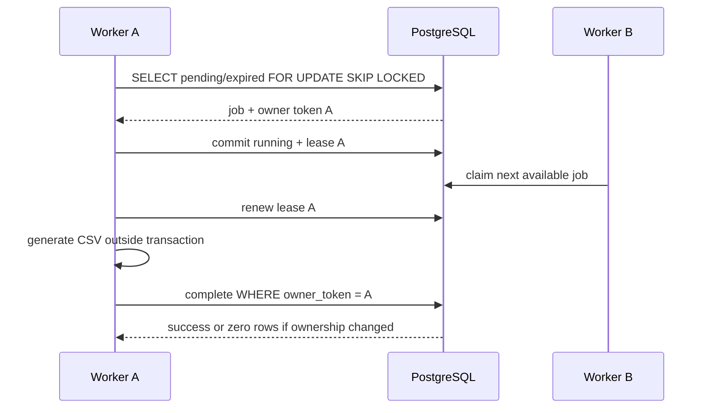

#### Verification and evidence
- The isolated concurrency exercise measured sequential waits at 1.60 seconds and bounded concurrency of two at 0.80 seconds with maximum active count two.
- `tests/test_jobs.py` passed 6 tests, including concurrent distinct claims and expired-owner rejection.
- Full `\.venv\Scripts\python.exe -m pytest -q tests` passed with 106 tests and two dependency deprecation warnings.
- Ruff check passed; format check reported 46 files already formatted.

#### Known limitations after this day
Lease expiry does not stop an old worker. A worker that loses ownership may still create an orphan output before conditional completion rejects it. No live process-kill/restart test, multi-process load test, lease tuning measurement, retry policy, idempotency key, or crash-safe artifact finalization exists yet. CPU-heavy export work remains in threads and is not moved to a process pool.

#### Related decisions and next design step
No new ADR was created; the implementation follows the roadmap's PostgreSQL job design. Next design step is Day 17 / W3.3: idempotency keys, bounded retries, payload fingerprints, and safe output finalization.

### Day 17 - W3.3: Idempotency and reliable retries
- Calendar date(s): 2026-09-23
- Status: Completed
#### What changed
No runtime architecture change. The theory checkpoint clarified the planned idempotency contract and the evidence required to reconcile output after a stale lease. The current architecture remains PostgreSQL-backed jobs with at-least-once execution semantics.
#### Why the design changed
A committed request can have a lost response, causing a client retry. A lease can also expire after a worker has created an output. Both cases require a stable logical operation identity independent of the HTTP response and worker process.
#### Boundary placement and ownership
The future idempotency record will be owned by PostgreSQL and scoped to the authenticated operation context. The API will compare a canonical request fingerprint; PostgreSQL uniqueness will protect concurrent creation. Worker artifact metadata will identify the export/job operation and support integrity checks. These are planned boundaries, not implemented behavior.
#### API, data, and compatibility impact
Planned behavior: new key creates an operation; same key and same fingerprint replays the existing operation; same key and different fingerprint returns `409 Conflict`. No endpoint or schema change has been implemented in this checkpoint.
#### Verification and evidence
Learner correctly selected `409 Conflict` for same-key/different-payload reuse and identified stable operation identity, attempt, output location, checksum, output status, and metadata as reconciliation evidence. No runtime validation was run because implementation has not started.
#### Known limitations after this day
The current code still has no idempotency table, fingerprinting, retry policy, or artifact finalization protocol. The old worker may still create an orphan output after lease loss. Exactly-once execution is not claimed.
#### Related decisions and next design step
Transactional outbox remains a future comparison, not current implementation. Next step: choose the idempotency schema and implement the atomic key/export/job creation path with concurrent duplicate tests.

#### Implementation follow-up - 2026-09-23
The design is now implemented. Migration `0008_retries_artifacts` adds attempt state, retry timing, and output checksums. Idempotency keys are scoped by user, workspace, operation, and key. Retryable failures return jobs to `pending` until `max_attempts`; terminal failures become `failed`. Workers generate attempt-specific temporary files, checksum them, atomically finalize them, and conditionally record the output under the current owner token. Full validation passed with 116 tests. Remaining limitations are live process recovery, object storage, cleanup policy, secure downloads, and future outbox publication.

### Day 18 - W3.4: Search and files
- Calendar date(s): 2026-09-23
- Status: Completed
#### What changed
Added workspace-wide task search through repository, service, and HTTP layers; enabled PostgreSQL `pg_trgm`/GIN indexing for substring matching; added authorized CSV download; added storage-root containment, formula-safe CSV cells, missing-artifact handling, and bounded retention cleanup.
#### Why the design changed
TaskForge needs search that remains tenant-scoped and file delivery that does not turn filesystem paths into authorization. Substring search matches the current simple title-containment requirement; full-text and semantic search are deferred until measured relevance or scale justifies them.
#### Boundary placement and ownership
The future search repository will own the workspace predicate, bounded query, and deterministic ordering. The service/API will authenticate and authorize the workspace before returning results. Download authorization will load the export through its workspace membership before resolving a server-controlled artifact path. Storage inconsistency will be logged and returned as a sanitized server error.
#### API, data, and compatibility impact
The API now exposes `GET /api/v1/workspaces/{workspace_id}/tasks/search` and `GET /api/v1/exports/{export_id}/download`. Migration `0009_add_task_title_trigram_index` enables the title trigram index. Download returns `409` when not ready, `410` after intentional retention expiry, and `500` for unexpected storage inconsistency.
#### Verification and evidence
Learner correctly compared substring and full-text semantics, identified the leading-wildcard limitation, and distinguished missing resources, not-ready exports, missing succeeded artifacts, and expired artifacts. Focused search/authorization tests passed with `40 passed`; download tests passed with `4 passed`; formula/traversal/retention tests passed; the full test suite and requested lint/format checks passed.
#### Known limitations after this day
Search remains substring-only and has no measured production workload/query plan. Retention cleanup is callable but not scheduled by a production lifecycle process. Cloud object storage, presigned URLs, and semantic search remain deferred.
#### Related decisions and next design step
Next step: Day 19 / W3.5 dependency resilience—make timeout budgets, retry ownership, and dependency failure behavior explicit.

### Day 19 - W3.5: Dependency resilience
- Calendar date(s): 2026-09-27
- Status: Completed
#### What changed
Added the separate `src/taskforge/resilience_lab.py` module with scripted dependency outcomes, a fake clock, one retry owner, deadline propagation, circuit-breaker states, a half-open probe, a bounded bulkhead, and a combined resilience wrapper.
#### Why the design changed
TaskForge will eventually call dependencies that can be slow or unavailable. A fixed timeout at each layer can exceed the original request budget, and a timeout does not prove the remote operation did not occur. The resilience lab makes these failure semantics explicit before applying them to a critical project path.
#### Boundary placement and ownership
The Day 19 mock adapter and circuit breaker will remain separate from the critical TaskForge API/export path. The adapter owns controllable delay/status behavior; the caller owns the overall deadline and one retry policy; the breaker owns temporary call admission based on recent failures.
#### API, data, and compatibility impact
No production API or schema change. The resilience lab is intentionally separate from critical TaskForge request and export paths.
#### Verification and evidence
Required gRPC deadline and AWS backoff/jitter sources were reviewed. The learner correctly explained deadline propagation, timeout uncertainty, retry amplification, retry classification, circuit transitions, bulkheads, and bounded degradation. Focused resilience tests passed, and the full test, Ruff, and format validation gates passed after PostgreSQL was restored.
#### Known limitations after this day
The lab does not prove real network cancellation, multi-process coordination, production dependency metrics, or scheduler/service-mesh integration. Circuit and retry policies are educational defaults, not production tuning.
#### Related decisions and next design step
No production resilience ADR was created because the implementation is an isolated lab. Next step: Day 20 / W3.6 protocol and real-time communication choices.

### Day 20 - W3.6: Real-time and communication choices
- Calendar date(s): 2026-09-27
- Status: Completed
#### What changed
Added an initial in-process workspace update broker and authenticated WebSocket route with bounded queues, origin validation, membership authorization, disconnect cleanup, and resync signaling for slow consumers.
#### Why the design changed
Polling remains the reliable status mechanism, but the lab needs to demonstrate push updates and the resource lifecycle of long-lived connections. A bounded in-process broker makes backpressure and single-instance limitations visible without introducing a broker or event platform prematurely.
#### Boundary placement and ownership
`src/taskforge/realtime.py` owns subscriber queues and event fan-out. The WebSocket route owns Origin validation, cookie-session authentication, workspace membership authorization, and connection cleanup. The lab publisher owns event creation; no task mutation route is coupled to delivery yet.
#### API, data, and compatibility impact
The lab adds `GET /api/v1/workspaces/{workspace_id}/updates` as a WebSocket route and a configurable allowed-Origin list. No database or production task-event schema change exists yet.
#### Verification and evidence
The learner selected SSE for one-way export status, WebSocket for interactive workspace updates, and durable events for worker completion. The learner correctly explained per-task monotonic versions, reconnect/refetch from PostgreSQL, and the need for an outbox to make durable publication atomic. WebSocket/broker tests cover authorized delivery, outsider rejection, disallowed Origin, and bounded slow-consumer behavior. The learner reported that Ruff, format checking, focused real-time tests, and the full test suite all passed.
#### Known limitations after this day
Delivery is in-process and single-instance only; events are not durable, replayable, or ordered across processes. Reconnect/refetch behavior and protocol comparisons remain incomplete.
#### Related decisions and next design step
No production real-time ADR yet. The current broker is synthetic and does not publish actual task mutations. Next step: Day 21 recovery review and failure-injection demonstration.

### Day 21 - W3.7: Recovery review
- Calendar date(s): 2026-09-28
- Status: Completed
#### What changed
No runtime architecture change yet. The session is beginning with a failure-oriented review of the existing job, lease, retry, idempotency, artifact, search, and connection behavior.
#### Why the design changed
Recovery claims need controlled evidence. A passing happy-path test does not establish that accepted work survives worker loss, request replay remains one logical operation, retries stay bounded, or optional dependencies fail safely.
#### Boundary placement and ownership
The recovery review will exercise existing PostgreSQL job state, worker ownership tokens and leases, idempotency records, artifact metadata, and the resilience lab. It will keep PostgreSQL authoritative and distinguish observed behavior from general guarantees.
#### API, data, and compatibility impact
None at orientation. Any implementation change will be recorded after the debugging exercise identifies a concrete defect.
#### Verification and evidence
The learner correctly diagnosed expired-lease reclamation and stale-worker fencing. Regression tests verify that an artifact promoted before fenced completion rejection is removed and that a later worker recovers a durable expired claim. The learner reported focused recovery validation with 27 tests, controlled restart validation with 1 test, and the final Ruff, format, and full-suite gates passed. An actual OS process kill remains unverified.
#### Known limitations after this day
The review did not run an actual OS process kill during CSV generation, multi-instance recovery, or production storage cleanup. The controlled restart test demonstrates durable expired-claim recovery but does not establish exactly-once execution or universal losslessness.
#### Related decisions and next design step
The recovery review is complete with observed behavior recorded in the failure matrix. Next step: Day 22 / W4.1 observability and SLOs.

### Day 22 - W4.1: Observability and SLOs
- Calendar date(s): 2026-09-28
- Status: Completed
#### What changed
No runtime architecture change yet. The module begins by defining the signals needed to diagnose request latency, database latency, queue delay, job execution, cache behavior, and dependency failures.
#### Why the design changed
Existing structured access logs show request outcomes, but logs alone cannot efficiently answer tail-latency, queue-age, error-rate, or cross-layer-correlation questions. The observability increment will add bounded, low-cardinality measurements and trace context without exposing secrets or unbounded user identifiers.
#### Boundary placement and ownership
The application will own request and job instrumentation; PostgreSQL and Redis remain dependencies whose latency and error outcomes must be measured at their call boundaries. SLO definitions will describe user-visible outcomes, not internal component health alone.
#### API, data, and compatibility impact
None at orientation. Planned telemetry must not change API behavior or persist sensitive payloads.
#### Verification and evidence
The learner correctly distinguished queue delay from execution delay, selected bounded metric labels, explained tail latency, defined a 99.9% export-status SLO, and described error-budget response. The bounded HTTP metrics increment passed focused tests and the learner reported Ruff, format, and full-suite validation passed.
#### Known limitations after this day
Metrics are process-local and not exported to a time-series backend. Database, cache, job, dependency, and trace instrumentation remain incomplete; the SLO is proposed rather than continuously measured.
#### Related decisions and next design step
Next step: Day 23 / W4.2 load and capacity measurement.

### Day 23 - W4.2: Load and capacity
- Calendar date(s): 2026-09-28
- Status: In Progress
#### What changed
No runtime architecture change yet. The module begins by defining a reproducible workload and the measurements needed to understand throughput, latency, queue age, pool waits, and resource saturation.
#### Why the design changed
Performance targets without a workload, dataset, warmup, duration, and resource context are not useful evidence. TaskForge needs a measured baseline before selecting a bottleneck to fix.
#### Boundary placement and ownership
The load harness will own workload generation and reporting. The application will expose the measured request/job/cache signals; PostgreSQL, Redis, workers, and the host remain resources whose saturation must be observed rather than inferred.
#### API, data, and compatibility impact
None at orientation. The workload should use existing authenticated endpoints and must not change production API semantics.
#### Verification and evidence
The first 50-user run with the initial API pool (`pool_size=5`, `max_overflow=0`) produced repeated 5-second pool timeouts and approximately 56% failures, confirming API-side PostgreSQL pool exhaustion. The final CSV-backed pool-20 rerun completed 17,933 requests at 24.94 requests/sec with 6 failures (`0.03%`); aggregate p50 was 37 ms, p95 77 ms, p99 130 ms, p99.9 1,200 ms, and maximum 1,600 ms. A cold-cache run completed 17,854 requests with 3 rate-limit failures at 24.88 requests/sec; a warm-cache run completed 17,660 requests with 58 failures (`0.33%`), including deferred `404`/`500` diagnosis. The pool bottleneck was reduced and the required baseline comparison was recorded.
#### Known limitations after this day
The result is a local baseline, not a production capacity claim. The task-list `401`s and warm-run `404`/`500`s were deferred, resource values are post-run snapshots rather than peak time series, and database pool-wait time was not directly exported. Queue and export-duration snapshots were captured.

The detailed captured report is maintained in `performance-report.md`.
#### Related decisions and next design step
Next step: calculate in-flight work from throughput and average latency, then define the authenticated read/write/export workload mix.

#### Workload decision
The first baseline will use a fixed 20-workspace, 400-project, 40,000-task dataset; a 70% read, 20% write, and 10% export/status mix; and 50 virtual users ramped gradually. Cold-cache and warm-cache runs will be separate measurements. No capacity target is inferred before the baseline is observed.

#### Environment captured
Python 3.12.0, PostgreSQL 17.11, Redis 7.4.11, worker concurrency 2, database pool size 5, and max overflow 0 were recorded before the load harness was created.

#### Load harness
`load_tests/locustfile.py` owns the reproducible authenticated baseline workload. It uses environment-provided credentials and seeded workspace/project IDs, weights operations 70/20/10 across task reads, task writes, and export creation/status, and names requests with stable route templates. Dataset seeding and resource monitoring remain separate concerns.

#### Dataset seeding
`scripts/seed_load_data.py` owns deterministic local load-data creation. It uses stable UUIDs and conflict-safe PostgreSQL inserts for the planned 100 users, 20 workspaces, 400 projects, and 40,000 tasks. It is a disposable benchmark fixture, not an application startup migration.

#### Measured pool bottleneck
The initial 50-user run saturated the API's five-connection PostgreSQL pool and caused 5-second wait timeouts. The controlled rerun used `TASKFORGE_DATABASE_POOL_SIZE=20` and `TASKFORGE_DATABASE_MAX_OVERFLOW=10`. This improved the observed failure rate from roughly 56% to 0.03%, but the larger pool is a measured local test configuration rather than a universal production setting; it must be checked against PostgreSQL connection limits and other application processes.
