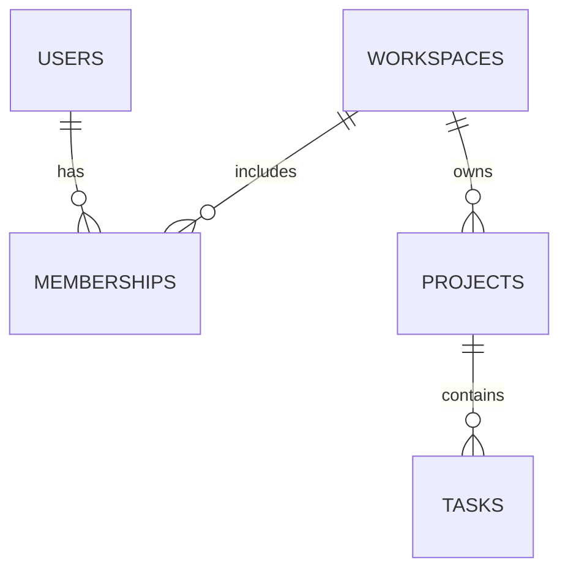

# TaskForge Relational Model

## Day 5 schema



## Tables

### users
- Primary key: `id uuid`
- Columns: `email`, `password_hash`, `created_at`
- Constraints: unique email, non-blank email, non-blank password hash

### workspaces
- Primary key: `id uuid`
- Columns: `name`, `created_at`
- Constraints: non-blank name

### memberships
- Primary key: `id uuid`
- Foreign keys: `user_id -> users.id`, `workspace_id -> workspaces.id`
- Columns: `role`, `created_at`
- Constraints: `UNIQUE (user_id, workspace_id)`, role in `owner`, `admin`, `member`

### projects
- Primary key: `id uuid`
- Foreign key: `workspace_id -> workspaces.id`
- Columns: `name`, `created_at`, `updated_at`
- Constraints: non-blank name

### tasks
- Primary key: `id uuid`
- Foreign key: `project_id -> projects.id`
- Columns: `title`, `status`, `created_at`, `updated_at`
- Constraints: non-blank title, status in `todo`, `in_progress`, `done`

## Ownership rule

Tasks belong to a workspace through their project:

```text
tasks.project_id -> projects.id
projects.workspace_id -> workspaces.id
```

Authorized task queries must join through `projects` and `memberships`.

## Authorized task query

```sql
SELECT
    t.id AS task_id,
    t.title AS task_title,
    t.status AS task_status,
    p.name AS project_name
FROM memberships AS m
JOIN projects AS p
    ON p.workspace_id = m.workspace_id
JOIN tasks AS t
    ON t.project_id = p.id
WHERE m.user_id = :user_id
  AND m.workspace_id = :workspace_id
  AND p.workspace_id = :workspace_id;
```

## Project task counts

```sql
SELECT
    p.id AS project_id,
    p.name AS project_name,
    count(t.id) AS task_count
FROM projects AS p
LEFT JOIN tasks AS t
    ON t.project_id = p.id
WHERE p.workspace_id = :workspace_id
GROUP BY p.id, p.name;
```
